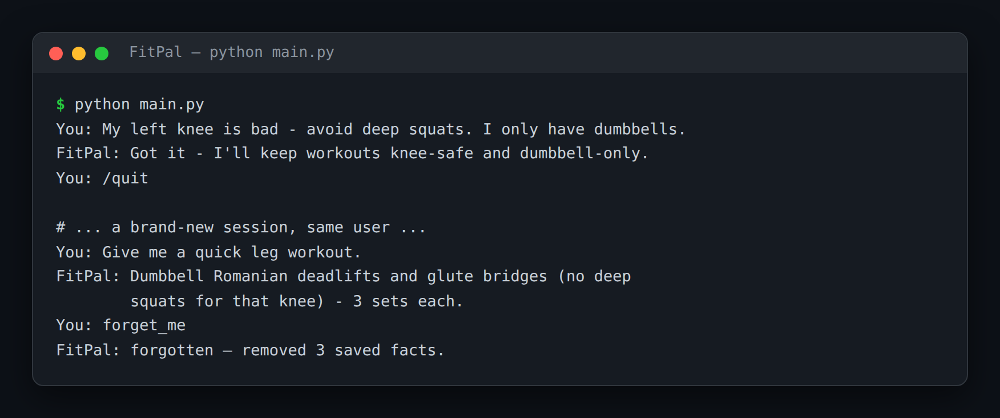

# FitPal — Persistent Fitness Coach With Cross-Session Memory

> **Short description:** A coaching assistant that remembers your goal, equipment, and injuries across **separate** conversations — so a brand-new session already knows your knee is bad before it writes a workout — and lets you wipe everything with `forget_me`. Two memory systems on a LangGraph graph: a per-conversation checkpointer and a per-user long-term store.

**Tech:** Python · LangGraph (`SqliteSaver` + `InMemoryStore`) · `langchain-openai` · Pydantic  ·  **Type:** Single-agent chat with long-term memory  ·  **Level:** Intermediate

## Demo



```
$ python main.py
You: My left knee is bad - avoid deep squats. I only have dumbbells.
FitPal: Got it - I'll keep workouts knee-safe and dumbbell-only.
# ...a brand-new session, same user...
You: Give me a quick leg workout.
FitPal: Sure - dumbbell Romanian deadlifts and glute bridges (no deep squats
for that knee)...
You: forget_me
FitPal: forgotten — removed 3 saved facts.
```

## Overview

A coach that forgets your bad knee between sessions is dangerous. FitPal remembers the things that matter, by keeping two kinds of memory straight:

- **Short-term (checkpointer, keyed by `thread_id`)** — this session's messages; a `SqliteSaver` persists a conversation across restarts.
- **Long-term (Store, keyed by `user_id`)** — durable facts about *you* (goal, equipment, injury), read by a brand-new session before it answers.

The hard part is **deciding what's worth saving** (most messages save nothing), saving under **stable keys** so a goal change updates instead of duplicating, and a `forget_me` that deletes **everything** — the privacy promise any health assistant must keep.

## Why

Any assistant people come back to is more useful when it remembers them and more trustworthy when it can forget them. The architecture is always the same: two memories kept separate, the judgement of what's worth keeping, and a respectful delete. With health data the stakes are concrete — the memory has to be deletable.

## Features

- Two memory systems: `SqliteSaver` checkpointer (per thread) + `InMemoryStore` (per user).
- A `recall_node` that loads your facts into the coaching system prompt.
- A `write_back_node` using a structured `MemoryDecision` to save only durable facts, under stable keys (goal/equipment/injury/schedule).
- A `forget_me` command that deletes **every** stored item for the user.

## Architecture

```
START -> recall -> chat -> write_back -> END

recall      : read the Store (by user_id) -> state["recalled"]
chat        : coaching prompt + recalled facts + conversation -> reply
write_back  : decide_memory(last user message) -> save durable facts only

checkpointer (SqliteSaver, by thread_id)  : this session's messages
store (InMemoryStore, by user_id)         : durable facts about the user
```

## Project Structure

```
<repo folder>/ (FitPal-Persistent-Fitness-Coach-With-Cross-Session-Memory/)
├── src/
│   ├── memory/                recall_facts/save_fact/forget_user; decide_memory
│   ├── models/llm.py          get_model()
│   ├── prompts/               chat.txt, writer.txt
│   ├── utils/                 logger.py, prompts.py
│   ├── __init__.py
│   ├── config.py
│   ├── exceptions.py
│   ├── graph.py               build_graph(model, store, checkpointer)
│   ├── nodes.py               recall_node, chat_node, write_back_node
│   └── state.py               ChatState
├── tests/
│   ├── integration/test_live_memory.py
│   └── unit/                  test_config, test_store
├── .env.example
├── .gitignore
├── LICENSE
├── main.py
├── README.md
└── requirements.txt
```

## Getting Started

**Requirements:** Python 3.10+ and an OpenAI API key.

```bash
git clone <this-repo-url>
cd FitPal-Persistent-Fitness-Coach-With-Cross-Session-Memory
python -m venv .venv
source .venv/bin/activate          # Windows: .venv\Scripts\activate
pip install -r requirements.txt
cp .env.example .env               # then put your key in .env
```

## Configuration

| Variable | Required | Default | Meaning |
|---|---|---|---|
| `OPENAI_API_KEY` | yes | — | Your OpenAI API key |
| `LOG_LEVEL` | no | `INFO` | Log verbosity |

## Usage

```bash
python main.py
# tell it your goal/equipment/injuries; a new session still knows them;
# type forget_me to wipe your memory.
```

## Running the Tests

```bash
# unit — no model, no network
python -m tests.unit.test_config
python -m tests.unit.test_store

# integration — real model: cross-session recall, write-back, forget
python -m tests.integration.test_live_memory
```

## Design Decisions

- **Two memory systems, kept separate** — the checkpointer is keyed by thread (this session); the Store is keyed by user (facts about you). A fact's home is decided by which question it answers.
- **Stable keys** — saving `goal` again updates it, so a new goal replaces the old instead of contradicting it.
- **The writer says no most of the time** — a structured `MemoryDecision` keeps the Store to durable facts, not every "felt tired today".
- **Deletable by design** — health facts *must* be wipeable; `forget_me` removes every key.

## Limitations and Roadmap

- `SqliteSaver` persists a conversation across restarts; `InMemoryStore` holds user facts for the life of the process. For user memory that survives a restart, swap in a file- or database-backed store with the same `put`/`get`/`search`/`delete` interface — no other code changes.

## License

MIT — see `LICENSE`.
