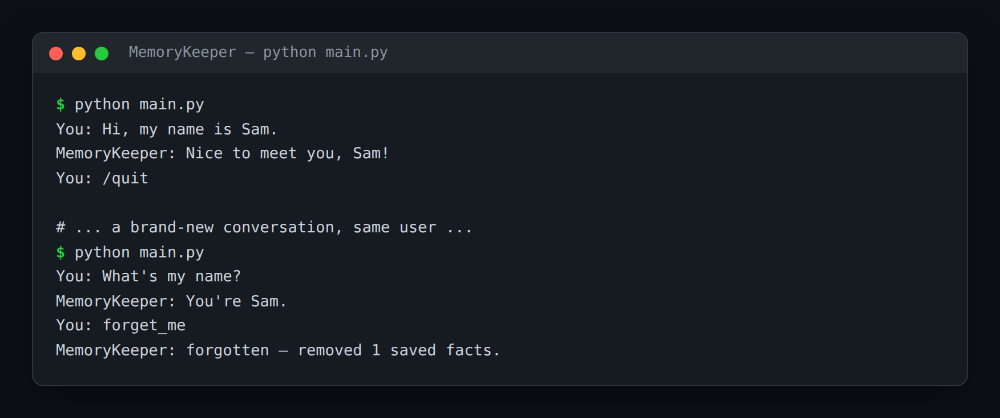

# MemoryKeeper — Persistent Assistant That Remembers You Across Sessions

> **Short description:** A chat assistant with **two memory systems** — a per-conversation checkpointer and a per-user long-term store — so a brand-new conversation still knows who you are. It decides for itself what's worth remembering (saying no far more than yes), updates a fact instead of duplicating it, and offers a real `forget_me`.

**Tech:** Python · LangGraph (`SqliteSaver` + `InMemoryStore`) · `langchain-openai` · Pydantic  ·  **Type:** Single-agent chat with long-term memory  ·  **Level:** Intermediate

## Demo



```
$ python main.py
You: Hi, my name is Sam.
MemoryKeeper: Nice to meet you, Sam!
# ...restart, brand-new conversation, same user...
You: What's my name?
MemoryKeeper: You're Sam.
You: forget_me
MemoryKeeper: forgotten — removed 1 saved facts.
```

## Overview

Most chatbots forget you between sessions. MemoryKeeper doesn't, because it keeps two kinds of memory straight:

- **Short-term (checkpointer, keyed by `thread_id`)** — the messages of *this* conversation. LangGraph's `SqliteSaver` persists a conversation across restarts.
- **Long-term (Store, keyed by `user_id`)** — durable facts about *you* (name, preferences), independent of any conversation. A brand-new thread reads these, so it already knows you.

The hard part isn't reading memory back — it's **deciding what's worth writing** (most messages save nothing), not duplicating a fact in different words, and offering a **privacy-respecting delete** that truly removes everything.

## Why

A real assistant should know you the second time you talk to it, in a conversation it has never seen. That takes two memory systems and the judgement to keep only durable facts. And anything that remembers you must be able to forget you — a delete that clears one field but leaves others is a privacy promise you didn't keep.

## Features

- Two memory systems: `SqliteSaver` checkpointer (per thread) + `InMemoryStore` (per user).
- A `recall_node` that loads your facts into the chat's system prompt — so a new thread knows you.
- A `write_back_node` that uses a structured `MemoryDecision` to save only durable facts, under a **stable key** (a rename updates, never duplicates).
- A `forget_me` command that deletes **every** stored item for a user.

## Architecture

```
START -> recall -> chat -> write_back -> END

recall      : read the Store (by user_id) -> state["recalled"]
chat        : system prompt + recalled facts + conversation -> reply
write_back  : decide_memory(last user message) -> save durable facts only

checkpointer (SqliteSaver, by thread_id)  : this conversation's messages
store (InMemoryStore, by user_id)         : durable facts about the user
```

## Project Structure

```
<repo folder>/ (MemoryKeeper-...-Remembers-You-Across-Sessions/)
├── src/
│   ├── memory/
│   │   ├── __init__.py
│   │   ├── store.py            recall_facts/save_fact/forget_user
│   │   └── writer.py           MemoryDecision, decide_memory
│   ├── models/llm.py           get_model()
│   ├── prompts/                chat.txt, writer.txt
│   ├── utils/                  logger.py, prompts.py
│   ├── __init__.py
│   ├── config.py
│   ├── exceptions.py
│   ├── graph.py                build_graph(model, store, checkpointer)
│   ├── nodes.py                recall_node, chat_node, write_back_node
│   └── state.py                ChatState
├── tests/
│   ├── integration/test_live_memory.py
│   └── unit/                   test_config, test_store
├── .env.example
├── .gitignore
├── LICENSE
├── main.py
├── README.md
└── requirements.txt
```

## Getting Started

**Requirements:** Python 3.10+ and an OpenAI API key.

```bash
git clone <this-repo-url>
cd MemoryKeeper-Persistent-Assistant-That-Remembers-You-Across-Sessions
python -m venv .venv
source .venv/bin/activate          # Windows: .venv\Scripts\activate
pip install -r requirements.txt
cp .env.example .env               # then put your key in .env
```

## Configuration

| Variable | Required | Default | Meaning |
|---|---|---|---|
| `OPENAI_API_KEY` | yes | — | Your OpenAI API key |
| `LOG_LEVEL` | no | `INFO` | Log verbosity |

## Usage

```bash
python main.py
# say your name, ask it back; start a new conversation and it still knows you;
# type forget_me to wipe your memory.
```

## Running the Tests

```bash
# unit — no model, no network
python -m tests.unit.test_config
python -m tests.unit.test_store

# integration — real model: cross-thread recall, write-back, forget
python -m tests.integration.test_live_memory
```

## Design Decisions

- **Two memory systems, kept separate** — the checkpointer is keyed by thread (this conversation); the Store is keyed by user (facts about you). A fact's home is decided by which question it answers.
- **Facts are keyed, not appended** — saving `preferred_name` again updates it, so "call me Sammy" replaces "Sam" instead of contradicting it.
- **The writer says no most of the time** — a structured `MemoryDecision` keeps the Store from becoming a junk drawer of one-off chatter.

## Limitations and Roadmap

- The checkpointer (`SqliteSaver`) persists a conversation across restarts; the Store (`InMemoryStore`) holds user facts for the life of the process. For user memory that survives a restart too, swap `InMemoryStore` for a file- or database-backed store with the same `put`/`get`/`search`/`delete` interface — no other code changes.

## License

MIT — see `LICENSE`.
