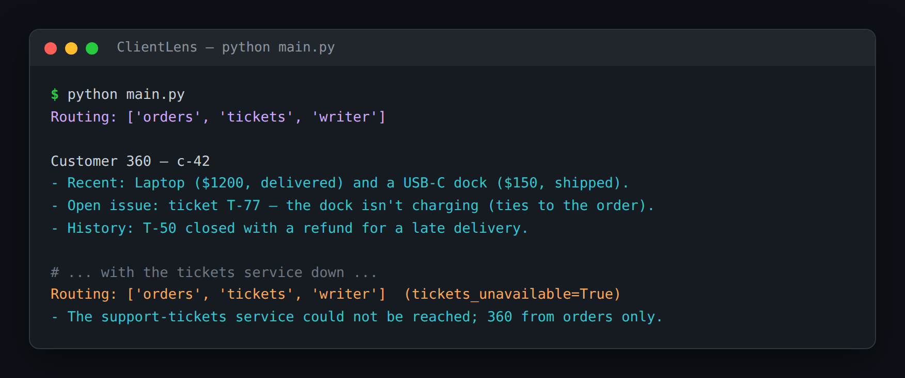

# ClientLens — Multi-Agent Customer-360 Team Over MCP Services

> **Short description:** A Supervisor-led team that assembles a customer-360 summary from two separate services — an **orders** MCP server and a **support-tickets** MCP server — each owned by its own specialist. A Writer synthesizes one summary, and a dead service degrades the team into an honest partial summary instead of crashing it.

**Tech:** Python · LangGraph (`Command`) · `mcp` (official MCP SDK) · OpenAI SDK · asyncio · Pydantic  ·  **Type:** Multi-agent (1 Supervisor + 3 specialists)  ·  **Level:** Advanced

## Demo



```
$ python main.py
Routing: ['orders', 'tickets', 'writer']

Customer 360 — c-42
- Recent: Laptop ($1200, delivered) and a USB-C dock ($150, shipped).
- Open issue: ticket T-77 — the dock isn't charging (ties to the dock order).
- History: T-50 closed with a refund for a late delivery.
```

## Overview

A support rep needs the whole customer picture at once — what they bought and what they complained about — but those live in two systems owned by two teams. ClientLens pulls them together:

- An **Orders Agent** connects to the orders MCP server; a **Tickets Agent** connects to the tickets MCP server — each its own connection.
- A **`Command`-based Supervisor** routes per request and *only* routes; it never touches a connection.
- A **Writer** synthesizes both specialists' findings into one 360 summary.
- **Graceful degradation**: a dead service is caught inside the specialist's own node; the summary is built from what's left and names the gap.

## Why

A real "assistant team" doesn't keep all its tools in one codebase — different capabilities are owned by different services. Giving each specialist its own connection means one service's failure can't touch another's work, and makes a dead service a partial-but-honest answer instead of a crash.

## Features

- Two specialists, each with its own stdio MCP connection (Project 8's client patterns).
- A shared `run_specialist` ReAct loop that opens/closes its connection inside one async call.
- A `Command` Supervisor that routes to specialist nodes and reads results from shared state.
- A Writer that synthesizes one 360 and names unavailable sources.
- Degradation via `asyncio.wait_for` + `try/except` **inside** the specialist node.

## Architecture

```
START -> supervisor --Command--> orders  (async, own MCP conn) --> supervisor
                      |-------->  tickets (async, own MCP conn) --> supervisor
                      |-------->  writer  (plain LLM, synthesize) --> END

degradation: service down -> run_specialist returns ("", unavailable=True)
             -> tickets_unavailable -> skip it -> writer names the gap
```

## Project Structure

```
<repo folder>/ (ClientLens-Multi-Agent-Customer-360-Team-Over-MCP-Services/)
├── servers/
│   ├── orders_server.py        get_orders
│   └── tickets_server.py       get_tickets
├── src/
│   ├── agents/
│   │   ├── __init__.py
│   │   ├── orders_agent.py     run_orders_agent()
│   │   ├── supervisor.py       decide_next(), supervisor()
│   │   ├── tickets_agent.py    run_tickets_agent()
│   │   └── writer_agent.py     run_writer()
│   ├── models/llm.py           create_client()
│   ├── utils/logger.py
│   ├── __init__.py
│   ├── config.py
│   ├── exceptions.py
│   ├── graph.py                build_graph(client)
│   ├── mcp_client.py           run_specialist()
│   └── state.py                TeamState
├── tests/
│   ├── integration/test_live_crew.py
│   └── unit/                   test_config, test_supervisor
├── .env.example
├── .gitignore
├── LICENSE
├── main.py
├── README.md
└── requirements.txt
```

## Getting Started

**Requirements:** Python 3.10+ and an OpenAI API key. The example servers run out of the box.

```bash
git clone <this-repo-url>
cd ClientLens-Multi-Agent-Customer-360-Team-Over-MCP-Services
python -m venv .venv
source .venv/bin/activate          # Windows: .venv\Scripts\activate
pip install -r requirements.txt
cp .env.example .env               # then put your key in .env
```

## Configuration

| Variable | Required | Default | Meaning |
|---|---|---|---|
| `OPENAI_API_KEY` | yes | — | Your OpenAI API key |
| `LOG_LEVEL` | no | `INFO` | Log verbosity |
| `MCP_CONNECT_TIMEOUT` | no | `10` | Seconds to wait for a server to start |

## Usage

```bash
python main.py
```

## Running the Tests

```bash
# unit — no model, no servers
python -m tests.unit.test_config
python -m tests.unit.test_supervisor

# integration — real MCP servers + model
python -m tests.integration.test_live_crew
```

## Error Handling

| Situation | What happens |
|---|---|
| `OPENAI_API_KEY` missing | Stops at startup with one clear line |
| A service is down | Caught inside that specialist's node; it returns "unavailable", the team continues |
| One source unavailable | The Writer names it in the 360; it never pretends the source was checked |

## Design Decisions

- **The Supervisor only routes** — each specialist owns its own MCP connection, so one failure can't touch another.
- **Specialists are async; the graph runs with `.ainvoke()`** — one consistent async pattern, so a connection in a node doesn't fight the loop.
- **Catch failures inside the specialist node** — the degradation flag threads through shared state to the Writer, instead of an exception crashing the graph.

## License

MIT — see `LICENSE`.
