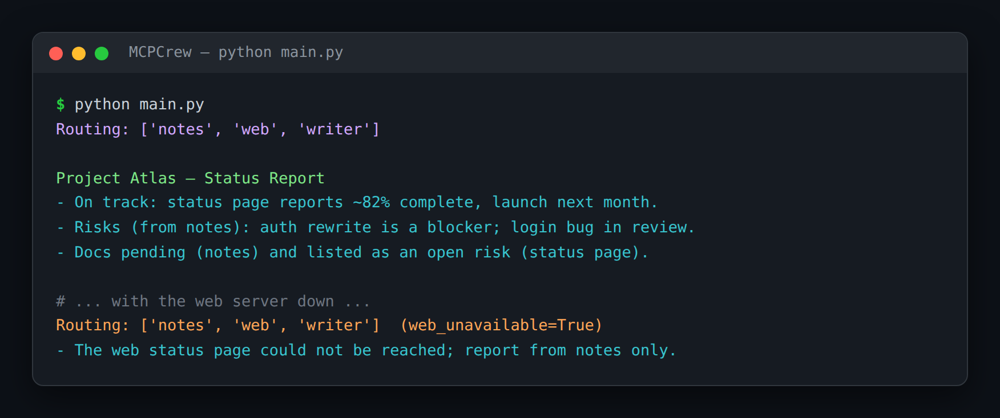

# MCPCrew — Multi-Agent Research Team Powered by MCP Servers

> **Short description:** A Supervisor-led research team where two specialists each open their **own** MCP server connection, a Writer synthesizes their findings into one report, and one specialist's dead server degrades the team into an honest partial report instead of crashing it.

**Tech:** Python · LangGraph (`Command`) · `mcp` (official MCP SDK) · OpenAI SDK · asyncio · Pydantic  ·  **Type:** Multi-agent (1 Supervisor + 3 specialists)  ·  **Level:** Advanced

## Demo



```
$ python main.py
Routing: ['notes', 'web', 'writer']

Project Atlas — Status Report
- On track: the status page reports ~82% complete, launch next month.
- Risks (from notes): auth rewrite is a blocker; a login bug is in review.
- Docs pending (notes) and listed as an open risk (status page).
```

## Overview

In a real company, different capabilities are owned by different teams, with different servers and uptimes. MCPCrew mirrors that: each specialist owns a narrow job and its own MCP connection.

- **Notes Agent** connects to a notes MCP server; **Web Agent** connects to a web-fetch MCP server — each its own connection.
- A **`Command`-based Supervisor** (Project 4's pattern) routes per request — and *only* routes; it never touches a connection.
- A **Writer** (a plain LLM call) synthesizes both specialists' findings into one coherent report.
- **Graceful degradation**: a dead server is caught inside the specialist's own node, which returns an "unavailable" result; the Writer says the source couldn't be reached.

## Why

Most real multi-agent systems don't have all their tools in one codebase. A team where each specialist owns its own external connection is a far more realistic shape than one agent with every tool hardcoded — and it means one specialist's failure never touches another's work.

## Features

- Two specialists, each with its own stdio MCP connection (reusing Project 8's client patterns).
- A shared `run_specialist` ReAct loop that opens and closes its connection inside one async call.
- A `Command` Supervisor that routes to specialist nodes and reads results from shared state.
- A Writer that synthesizes, not concatenates (and names unavailable sources).
- Degradation via `asyncio.wait_for` + `try/except` **inside** the specialist node — a dead server never crashes the graph.

## Architecture

```
START -> supervisor --Command--> notes (async, own MCP conn) --> supervisor
                      |-------->  web   (async, own MCP conn) --> supervisor
                      |-------->  writer (plain LLM, synthesize) --> END

each specialist node: run_specialist() connects to ITS server, loops, closes
degradation: server down -> run_specialist returns ("", unavailable=True)
             -> web_unavailable -> supervisor skips web -> writer says so
```

## Project Structure

```
<repo folder>/ (MCPCrew-Multi-Agent-Research-Team-Powered-By-MCP-Servers/)
├── servers/
│   ├── notes_server.py         add_note, search_notes
│   └── web_server.py           fetch_page (mocked)
├── src/
│   ├── agents/
│   │   ├── __init__.py
│   │   ├── notes_agent.py      run_notes_agent()
│   │   ├── supervisor.py       decide_next(), supervisor()
│   │   ├── web_agent.py        run_web_agent()
│   │   └── writer_agent.py     run_writer()
│   ├── models/llm.py           create_client()
│   ├── utils/logger.py
│   ├── __init__.py
│   ├── config.py
│   ├── exceptions.py
│   ├── graph.py                build_graph(client)
│   ├── mcp_client.py           run_specialist() — shared MCP ReAct loop
│   └── state.py                TeamState
├── tests/
│   ├── integration/test_live_crew.py
│   └── unit/                   test_config, test_supervisor
├── .env.example
├── .gitignore
├── LICENSE
├── main.py
├── README.md
└── requirements.txt
```

## Getting Started

**Requirements:** Python 3.10+ and an OpenAI API key. The example servers run out of the box.

```bash
git clone <this-repo-url>
cd MCPCrew-Multi-Agent-Research-Team-Powered-By-MCP-Servers
python -m venv .venv
source .venv/bin/activate          # Windows: .venv\Scripts\activate
pip install -r requirements.txt
cp .env.example .env               # then put your key in .env
```

## Configuration

| Variable | Required | Default | Meaning |
|---|---|---|---|
| `OPENAI_API_KEY` | yes | — | Your OpenAI API key |
| `LOG_LEVEL` | no | `INFO` | Log verbosity |
| `MCP_CONNECT_TIMEOUT` | no | `10` | Seconds to wait for a server to start |

## Usage

```bash
python main.py
```

## Running the Tests

```bash
# unit — no model, no servers
python -m tests.unit.test_config
python -m tests.unit.test_supervisor

# integration — real MCP servers + model
python -m tests.integration.test_live_crew
```

## Error Handling

| Situation | What happens |
|---|---|
| `OPENAI_API_KEY` missing | Stops at startup with one clear line |
| A specialist's server is down | Caught inside that specialist's node; it returns "unavailable", the team continues |
| One source unavailable | The Writer names it in the report; it never pretends the source was checked |

## Design Decisions

- **The Supervisor only routes** — it never opens an MCP connection; each specialist owns its own, so one failure can't touch another.
- **Specialists are async; the graph runs with `.ainvoke()`** — one consistent async pattern, so a connection in a node doesn't fight the event loop.
- **Catch failures inside the specialist node** — the degradation flag threads through shared state to the Writer, instead of an exception escaping to crash the graph.

## License

MIT — see `LICENSE`.
