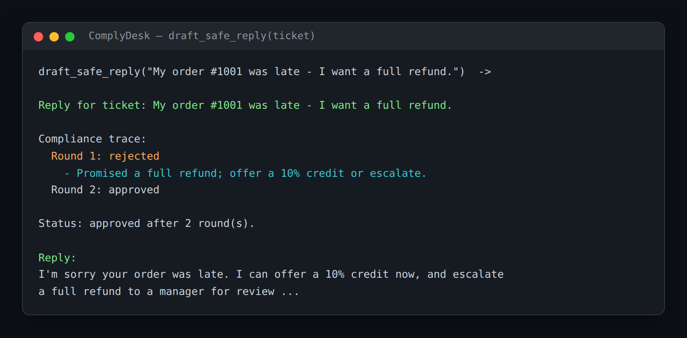

# ComplyDesk — Policy-Checked Support Replies Behind One MCP Tool

> **Short description:** A Drafter→Compliance-Checker revision pipeline, exposed to any MCP client as a single `draft_safe_reply(ticket)` tool — the "agent-as-a-service" pattern. One call drafts a reply, checks it against company policy (refunds, guarantees, info leaks), revises until it's compliant (capped), returns it with a trace, and falls back to a marked partial on timeout so it never hangs.

**Tech:** Python · `mcp` SDK (MCPServer) · `langchain-openai` · asyncio · Pydantic  ·  **Type:** MCP Server (1 Tool wrapping a 2-agent pipeline)  ·  **Level:** Advanced

## Demo



```
draft_safe_reply("My order #1001 was late - I want a full refund.")  ->

Reply for ticket: My order #1001 was late - I want a full refund.

Compliance trace:
  Round 1: rejected
    - Promised a full refund; agents may offer a 10% credit or escalate.
  Round 2: approved

Status: approved after 2 round(s).

Reply:
I'm sorry your order arrived late. I can offer a 10% credit now, and escalate
a full refund to a manager for review ...
```

## Overview

A support team wants their tools to draft replies — but a reply promising an unauthorized refund or "guaranteeing" something is worse than none. ComplyDesk offers one checked capability:

- A **Drafter** writes a reply; a **Compliance-Checker** rejects it with specific issues if it breaks policy (unauthorized refund, absolute guarantee, info leak).
- The Drafter fixes exactly those issues, bounded by a hard round cap.
- All of it is behind one `draft_safe_reply(ticket) -> str` MCP tool, returning a **compliance trace** so a slow call isn't a black box, and a **timeout + partial fallback** so it never hangs.

## Why

Offering a whole generate-then-verify workflow as one protocol-callable capability lets other teams' tools use it without re-implementing the policy rules. The skill is deciding what a slow, multi-step process looks like from the outside — a trace, a timeout, a partial.

## Features

- A capped Drafter/Compliance-Checker revise loop (Project 4's Writer/Reviewer pattern) as one MCP tool.
- Real policy criteria in the checker's prompt (refunds, guarantees, info leaks).
- A compliance trace returned alongside the reply.
- A timeout + "best draft so far" partial fallback (`asyncio.to_thread` + `asyncio.wait_for`).
- Logging to stderr (stdout is the MCP protocol channel).

## Architecture

```
MCP client --draft_safe_reply(ticket)--> MCPServer tool (async)
   |
   await wait_for(to_thread(run_pipeline, ...), timeout)
        |                                   |
   run_pipeline (sync, worker thread)       on timeout -> format_partial
        Drafter -> Compliance-Checker -> approved? stop : feedback -> repeat
        (bounded by MAX_REVISION_ROUNDS; Progress holder records each round)
   |
   format_result(result)  ->  compliance trace + status + reply  ->  client
```

## Project Structure

```
<repo folder>/ (ComplyDesk-Policy-Checked-Support-Replies-As-One-MCP-Tool/)
├── src/
│   ├── agents/
│   │   ├── compliance_checker.py  ComplianceVerdict, run_compliance()
│   │   └── drafter.py             Draft, run_drafter()
│   ├── models/llm.py              get_model()
│   ├── prompts/                   drafter.txt, compliance.txt
│   ├── utils/                     logger.py (stderr), prompts.py
│   ├── __init__.py
│   ├── config.py
│   ├── exceptions.py
│   ├── formatting.py              format_result(), format_partial()
│   └── pipeline.py                run_pipeline(), PipelineResult, Progress
├── tests/
│   ├── integration/test_live_tool.py
│   └── unit/                      test_config, test_formatting, test_pipeline
├── .env.example
├── .gitignore
├── LICENSE
├── main.py                        the pipeline standalone
├── mcp_server.py                  the draft_safe_reply tool
├── README.md
└── requirements.txt
```

## Getting Started

**Requirements:** Python 3.10+ and an OpenAI API key.

```bash
git clone <this-repo-url>
cd ComplyDesk-Policy-Checked-Support-Replies-As-One-MCP-Tool
python -m venv .venv
source .venv/bin/activate          # Windows: .venv\Scripts\activate
pip install -r requirements.txt
cp .env.example .env               # then put your key in .env
```

## Configuration

| Variable | Required | Default | Meaning |
|---|---|---|---|
| `OPENAI_API_KEY` | yes | — | Your OpenAI API key |
| `LOG_LEVEL` | no | `INFO` | Log verbosity (to stderr) |
| `MAX_REVISION_ROUNDS` | no | `3` | Hard cap on revise rounds |
| `REPLY_TIMEOUT_SECONDS` | no | `60` | Timeout before the partial fallback |

## Usage

```bash
python main.py            # the pipeline standalone
mcp dev mcp_server.py     # call draft_safe_reply by hand in the MCP Inspector
```

## Running the Tests

```bash
# unit — no model, no network
python -m tests.unit.test_config
python -m tests.unit.test_formatting
python -m tests.unit.test_pipeline

# integration — real model, via the MCP tool
python -m tests.integration.test_live_tool
```

## Error Handling

| Situation | What happens |
|---|---|
| `OPENAI_API_KEY` missing | Stops at startup with one clear line |
| Checker never approves | The loop stops at `MAX_REVISION_ROUNDS`; the trace says "send to a human" |
| The run exceeds the timeout | Returns a marked PARTIAL with the best draft so far — no hang |

## Design Decisions

- **Keep the layers separate** — Drafter, Compliance-Checker, pipeline (loop + cap), MCP tool (format, timeout). The timeout lives around the whole pipeline call, not in the Drafter.
- **`to_thread` before `wait_for`** — the pipeline is synchronous; run it on a thread so the timeout can fire.
- **A `Progress` holder** — so the partial fallback returns the best draft produced before the clock ran out.

## License

MIT — see `LICENSE`.
