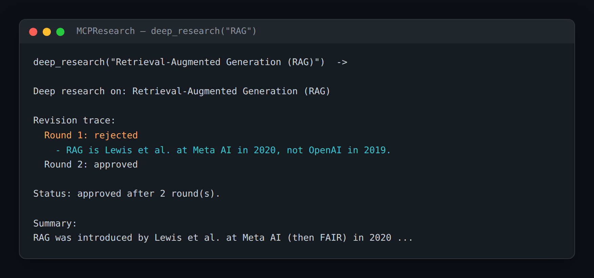

# MCPResearch — A Fact-Checked Research Pipeline Behind One MCP Tool

> **Short description:** A Researcher→Fact-Checker revision pipeline, exposed to any MCP client as a single `deep_research(topic)` tool — the "agent-as-a-service" pattern. One call runs a multi-round, capped, fact-checked loop, returns the summary with a short revision trace, and falls back to a marked partial answer on timeout so it never hangs.

**Tech:** Python · `mcp` SDK (MCPServer) · `langchain-openai` · asyncio · Pydantic  ·  **Type:** MCP Server (1 Tool wrapping a 2-agent pipeline)  ·  **Level:** Advanced

## Demo



```
deep_research("Retrieval-Augmented Generation (RAG)")  ->

Deep research on: Retrieval-Augmented Generation (RAG)

Revision trace:
  Round 1: rejected
    - RAG was introduced by Lewis et al. at Meta AI in 2020, not OpenAI in 2019.
  Round 2: approved

Status: approved after 2 round(s).

Summary:
Retrieval-Augmented Generation (RAG) was introduced by Lewis et al. at Meta AI
(then Facebook AI Research) in 2020 ...
```

## Overview

A teammate wants "a fact-checked summary of X" without building a research agent. You give them one function. Underneath, a two-agent loop runs — but they see only a clean, checked answer.

- A **Researcher** drafts a summary; a **Fact-Checker** rejects it with specific issues; the Researcher fixes exactly those, bounded by a hard round cap.
- All of it is hidden behind one `deep_research(topic) -> str` MCP tool any client can call.
- The result carries a **revision trace**, so a slow multi-round call isn't a black box.
- A **timeout + partial fallback** means a slow or broken run returns a marked "best draft so far", not a hang.

## Why

"Agent-as-a-service" — a whole workflow offered as one callable capability over a standard protocol — is a real production pattern. It's a harder skill than building a simple MCP server or an agent that calls one: *you* decide what a slow, multi-step process should look like from the outside (a trace, a timeout, a partial).

## Features

- A capped Researcher/Fact-Checker revise loop (Project 4's Writer/Reviewer pattern) exposed as one MCP tool.
- A revision trace returned alongside the summary.
- A timeout + "best draft so far" partial fallback (`asyncio.to_thread` + `asyncio.wait_for`), so the tool always returns something.
- Logging to stderr (stdout is the MCP protocol channel).

## Architecture

```
MCP client --deep_research(topic)--> MCPServer tool (async)
   |
   await wait_for(to_thread(run_pipeline, ...), timeout)
        |                                   |
   run_pipeline (sync, on a worker thread)  on timeout -> format_partial
        Researcher -> Fact-Checker -> approved? stop : feedback -> repeat
        (bounded by MAX_REVISION_ROUNDS; Progress holder records each round)
   |
   format_result(result)  ->  trace + status + summary  ->  client
```

## Project Structure

```
<repo folder>/ (MCPResearch-Multi-Agent-Pipeline-Exposed-As-One-MCP-Tool/)
├── src/
│   ├── agents/
│   │   ├── fact_checker.py     FactCheckVerdict, run_fact_checker()
│   │   └── researcher.py       Draft, run_researcher()
│   ├── models/llm.py           get_model()
│   ├── prompts/                researcher.txt, fact_checker.txt
│   ├── utils/                  logger.py (stderr), prompts.py
│   ├── __init__.py
│   ├── config.py
│   ├── exceptions.py
│   ├── formatting.py           format_result(), format_partial()
│   └── pipeline.py             run_pipeline(), PipelineResult, Progress
├── tests/
│   ├── integration/test_live_tool.py
│   └── unit/                   test_config, test_formatting, test_pipeline
├── .env.example
├── .gitignore
├── LICENSE
├── main.py                     the pipeline standalone
├── mcp_server.py               the deep_research tool
├── README.md
└── requirements.txt
```

## Getting Started

**Requirements:** Python 3.10+ and an OpenAI API key.

```bash
git clone <this-repo-url>
cd MCPResearch-Multi-Agent-Pipeline-Exposed-As-One-MCP-Tool
python -m venv .venv
source .venv/bin/activate          # Windows: .venv\Scripts\activate
pip install -r requirements.txt
cp .env.example .env               # then put your key in .env
```

## Configuration

| Variable | Required | Default | Meaning |
|---|---|---|---|
| `OPENAI_API_KEY` | yes | — | Your OpenAI API key |
| `LOG_LEVEL` | no | `INFO` | Log verbosity (to stderr) |
| `MAX_REVISION_ROUNDS` | no | `3` | Hard cap on revise rounds |
| `DEEP_RESEARCH_TIMEOUT_SECONDS` | no | `60` | Timeout before the partial fallback |

## Usage

```bash
python main.py            # the pipeline standalone
mcp dev mcp_server.py     # call deep_research by hand in the MCP Inspector
```

## Running the Tests

```bash
# unit — no model, no network
python -m tests.unit.test_config
python -m tests.unit.test_formatting
python -m tests.unit.test_pipeline

# integration — real model, via the MCP tool
python -m tests.integration.test_live_tool
```

## Error Handling

| Situation | What happens |
|---|---|
| `OPENAI_API_KEY` missing | Stops at startup with one clear line |
| Fact-Checker never approves | The loop stops at `MAX_REVISION_ROUNDS`; the trace shows it |
| The run exceeds the timeout | Returns a marked PARTIAL with the best draft so far — no hang |

## Design Decisions

- **Keep the layers separate** — the Researcher's job, the Fact-Checker's job, the pipeline's job (loop + cap), and the MCP layer's job (format, timeout, fallback) are each in their own file. The timeout lives around the *whole pipeline call*, not inside the Researcher.
- **`to_thread` before `wait_for`** — the pipeline is synchronous; running it in a thread keeps the event loop free so the timeout can actually fire.
- **A `Progress` holder** — so the partial fallback can return the best draft produced before the clock ran out.

## License

MIT — see `LICENSE`.
