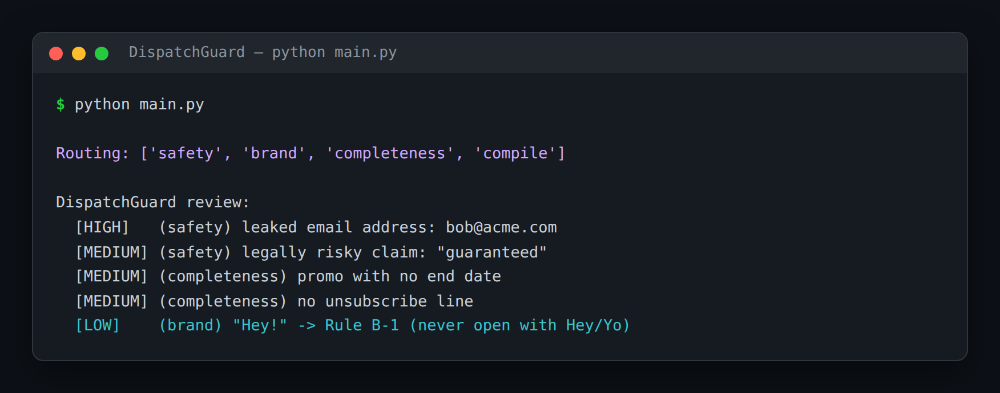

# DispatchGuard — Multi-Agent Outgoing-Message Review in One Pass

> **Short description:** A Supervisor-led team of three specialist reviewers — Safety, Brand (grounded in your real voice guide via RAG), and Completeness — that reads an outgoing customer message and returns one compiled, de-duplicated, severity-sorted verdict before it's sent. The Supervisor routes each message by its type, so an internal memo never pays for a brand check.

**Tech:** Python · LangGraph (`Command`) · LangChain · RAG (Chroma) · OpenAI SDK · Pydantic  ·  **Type:** Multi-agent (1 Supervisor + 3 reviewers)  ·  **Level:** Advanced

## Demo



```
Routing: ['safety', 'brand', 'completeness', 'compile']

DispatchGuard review:
  [HIGH]   (safety) leaked email address: bob@acme.com
  [MEDIUM] (safety) legally risky claim: "guaranteed"
  [MEDIUM] (completeness) promo with no end date
  [MEDIUM] (completeness) no unsubscribe line
  [LOW]    (brand) "Hey!" -> Rule B-1 (never open with "Hey"/"Yo")
```

## Overview

Every day a company sends marketing blasts, order receipts, and internal memos. One bad message — a leaked email address, a "we guarantee results" claim legal would never approve, a sale with no end date — costs more than the message was worth. DispatchGuard reviews each one before it's sent: three specialists look it over, and a Supervisor merges their findings into one clear verdict.

- A **Supervisor** routes each message by its type (internal → Safety only; transactional → Safety + Completeness; marketing → all three).
- Three **specialist reviewers**, each doing one narrow, independently-tested job.
- The Brand reviewer is grounded in your **real voice guide** through RAG, so it cites your actual house-style rules.
- The Supervisor **compiles** all findings into one de-duplicated, severity-sorted verdict — not three reports stapled together.

## Why

This is the practice twin of CodeGuard (Project 13), in a domain with nothing in common with code review. Building the same architecture — a routing Supervisor, narrow grounded specialists, a compile step — a second time is the proof you learned the *shape*, not one app. "Combine several specialist checks into one verdict, and only run the ones that apply" fits content moderation, compliance review, multi-criteria approvals, and any pre-send check.

## Features

- Three independent specialist reviewers (Safety, Brand, Completeness), each tested standalone — including on a clean message — before joining the team.
- A deterministic Safety scanner (regex) for leaked PII, internal markers, and legally risky claims, so it is testable.
- A Brand reviewer grounded in a real, searched voice guide via RAG, citing the retrieved rule.
- A Supervisor that routes by message type, so an internal memo never runs Brand or Completeness.
- One compiled, de-duplicated, severity-sorted verdict instead of three raw reports.

## Architecture

```
outgoing message ([type] body)
   |
   START --> Supervisor (routes by message type)
                 |  internal      -> Safety
                 |  transactional -> Safety, Completeness
                 |  marketing     -> Safety, Brand, Completeness
                 v
   each reviewer runs, returns Command(goto="supervisor", findings+=)
                 |
                 v
   compile_review: dedup by (category, message), sort by severity
                 |
                 v
   one verdict  -->  END
```

## Project Structure

```
<repo folder>/ (the DispatchGuard repo — full name in the heading above)
├── data/
│   ├── sample_messages/        internal, transactional, marketing samples
│   └── voice_guide.md          your real house-style rules (RAG source)
├── src/
│   ├── agents/
│   │   ├── brand_reviewer.py       run_brand() (RAG + LLM)
│   │   ├── completeness_reviewer.py run_completeness()
│   │   ├── safety_reviewer.py      run_safety()
│   │   └── supervisor.py           choose_reviewers/decide_next/compile_review
│   ├── rag/                    ingest.py, retriever.py, store.py
│   ├── models/llm.py
│   ├── prompts/brand.txt
│   ├── utils/                  logger.py, prompts.py
│   ├── config.py
│   ├── exceptions.py
│   ├── graph.py                build_graph()
│   ├── message.py              parse_message()
│   ├── schemas.py              Finding
│   └── state.py                ReviewState, start_state()
├── tests/
│   ├── integration/test_live_review.py
│   └── unit/                   test_compile, test_config, test_message,
│                               test_routing, test_safety
├── .env.example
├── .gitignore
├── LICENSE
├── main.py
├── README.md
└── requirements.txt
```

## Getting Started

**Requirements:** Python 3.10+ and an OpenAI API key.

```bash
git clone <this-repo-url>
cd DispatchGuard-Multi-Agent-Outgoing-Message-Review-In-One-Pass
python -m venv .venv
source .venv/bin/activate          # Windows: .venv\Scripts\activate
pip install -r requirements.txt
cp .env.example .env               # then put your key in .env
```

## Configuration

| Variable | Required | Default | Meaning |
|---|---|---|---|
| `OPENAI_API_KEY` | yes | — | Your OpenAI API key |
| `LOG_LEVEL` | no | `INFO` | Log verbosity |

## Usage

```bash
python main.py            # run the full team on a sample message
```

## Running the Tests

```bash
# unit — no model, no network
python -m tests.unit.test_config
python -m tests.unit.test_message
python -m tests.unit.test_safety
python -m tests.unit.test_routing
python -m tests.unit.test_compile

# integration — real model + RAG
python -m tests.integration.test_live_review
```

## Error Handling

| Situation | What happens |
|---|---|
| `OPENAI_API_KEY` missing | Stops at startup with one clear line |
| The same issue raised twice | `compile_review` de-duplicates by (category, message) |
| An internal memo | Only Safety runs; Brand and Completeness are skipped |
| Nothing to flag | Returns "DispatchGuard: cleared to send." |

## Design Decisions

- **Safety and Completeness are deterministic** (regex/heuristics, not prompts) — that's what makes them testable, including the clean-message case that proves Safety stays quiet on good copy.
- **Brand is grounded by RAG, not prompting** — it can only cite a rule that's actually in your searched voice guide, so "it made up a rule" becomes a checkable failure.
- **The Supervisor only routes and compiles** — routing (skip irrelevant reviewers) and compiling (dedup + sort) are where the multi-agent value lives.
- **This is CodeGuard's architecture in a new domain** — same Supervisor + specialists + RAG + compile, proving the shape generalizes.

## License

MIT — see `LICENSE`.
