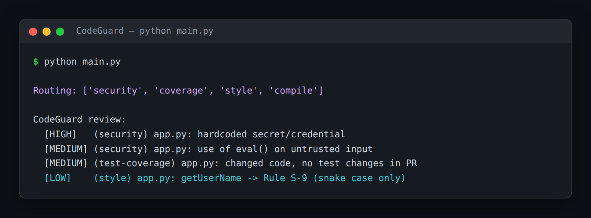

# CodeGuard — Multi-Agent PR Review in One Pass

> **Short description:** A Supervisor-led team of three specialist reviewers — Security, Style (grounded in your real style guide via RAG), and Test-Coverage — that turns a raw code diff into one compiled, de-duplicated, severity-sorted review comment. The Supervisor routes each diff only to the reviewers that actually apply.

**Tech:** Python · LangGraph (`Command`) · LangChain · RAG (Chroma) · OpenAI SDK · Pydantic · (optional FastAPI/Docker)  ·  **Type:** Multi-agent (1 Supervisor + 3 reviewers)  ·  **Level:** Advanced (capstone bonus)

## Demo



```
Routing: ['security', 'coverage', 'style', 'compile']

CodeGuard review:
  [HIGH]   (security) app.py: hardcoded secret/credential
  [MEDIUM] (security) app.py: use of eval() on untrusted input
  [MEDIUM] (test-coverage) app.py: changed code with no test changes in this PR
  [LOW]    (style) app.py: getUserName -> Rule S-9 (snake_case, no camelCase)
```

## Overview

A pull request lands. Before a human opens it, three specialists already looked it over: one for **security** (secrets left in code, unsafe patterns like `eval`), one for **style** against your team's *actual* guide (searched, not generic advice), one for **test coverage** (did the changed code get any tests?). A fourth — the lead **Supervisor** — reads all three, drops overlap, sorts by severity, and writes one clear comment.

- A **Supervisor** routes each diff to only the reviewers that apply (a docs-only change skips Security and Test-Coverage; a config-only change skips Style).
- Three **specialist reviewers**, each doing one narrow, independently-tested job.
- The Style reviewer is grounded in your **real style guide** through RAG, so it cites your actual rules.
- The Supervisor **compiles** all findings into one de-duplicated, severity-sorted comment — not three reports stapled together.

## Why

The point isn't the review; it's proving the patterns from Projects 1-12 **generalize**. A Supervisor that routes to the right specialist, specialists that stay narrow and grounded (Style uses RAG, not freelancing), the same production layer from Project 5 — that shape recurs everywhere: moderation, compliance, multi-criteria approvals. CodeGuard is the ContentForge shape pointed at a completely different problem, which is the real test of whether you learned an architecture or just one app.

## Features

- Three independent specialist reviewers (Security, Style, Test-Coverage), each tested standalone — including on a clean diff — before joining the team.
- A deterministic Security scanner (regex over added lines) for secrets and unsafe patterns, so it is testable.
- A Style reviewer grounded in a real, searched style-guide document via RAG, citing the retrieved rule.
- A Supervisor that routes by file category, so a docs-only diff never pays for a security check.
- One compiled, de-duplicated, severity-sorted review comment instead of three raw reports.
- Every reviewer sees only the diff's **added** lines, so it never flags pre-existing, unrelated code.
- Optional production wrap: a FastAPI `/review` endpoint, a routing eval, and Docker (reusing Project 5).

## Architecture

```
code diff
   |
   START --> Supervisor (routes by which file categories changed)
                 |  code     -> Security, Test-Coverage
                 |  code/docs -> Style (RAG over style_guide.md)
                 |  config    -> (skip Style)
                 v
   each reviewer runs, returns Command(goto="supervisor", findings+=)
                 |
                 v
   compile_review: dedup by (category, message), sort by severity
                 |
                 v
   one review comment  -->  END
```

## Project Structure

```
<repo folder>/ (the CodeGuard repo — full name in the heading above)
├── data/
│   ├── sample_diffs/           clean, secret, docs-only .diff files
│   └── style_guide.md          your real style rules (RAG source)
├── src/
│   ├── agents/
│   │   ├── coverage_reviewer.py  run_coverage()
│   │   ├── security_reviewer.py  run_security()
│   │   ├── style_reviewer.py     run_style() (RAG + LLM)
│   │   └── supervisor.py         choose_reviewers/decide_next/compile_review
│   ├── rag/                    ingest.py, retriever.py, store.py
│   ├── models/llm.py
│   ├── prompts/style.txt
│   ├── utils/                  logger.py, prompts.py
│   ├── config.py
│   ├── diff.py                 parse_diff(), categorize()
│   ├── exceptions.py
│   ├── graph.py                build_graph()
│   ├── schemas.py              Finding
│   └── state.py                ReviewState, start_state()
├── tests/
│   ├── integration/test_live_review.py
│   └── unit/                   test_compile, test_config, test_diff,
│                               test_routing, test_security
├── .env.example
├── .gitignore
├── LICENSE
├── main.py
├── README.md
└── requirements.txt
```

## Getting Started

**Requirements:** Python 3.10+ and an OpenAI API key.

```bash
git clone <this-repo-url>
cd CodeGuard-Multi-Agent-PR-Review-Security-Style-And-Test-Coverage-In-One-Pass
python -m venv .venv
source .venv/bin/activate          # Windows: .venv\Scripts\activate
pip install -r requirements.txt
cp .env.example .env               # then put your key in .env
```

## Configuration

| Variable | Required | Default | Meaning |
|---|---|---|---|
| `OPENAI_API_KEY` | yes | — | Your OpenAI API key |
| `LOG_LEVEL` | no | `INFO` | Log verbosity |

## Usage

```bash
python main.py            # run the full team on a sample diff
```

## Running the Tests

```bash
# unit — no model, no network
python -m tests.unit.test_config
python -m tests.unit.test_diff
python -m tests.unit.test_security
python -m tests.unit.test_routing
python -m tests.unit.test_compile

# integration — real model + RAG
python -m tests.integration.test_live_review
```

## Error Handling

| Situation | What happens |
|---|---|
| `OPENAI_API_KEY` missing | Stops at startup with one clear line |
| A reviewer flags pre-existing code | It can't — every reviewer sees only the diff's added lines |
| The same issue raised twice | `compile_review` de-duplicates by (category, message) |
| A docs-only diff | Security and Test-Coverage are skipped; only Style runs |

## Design Decisions

- **The Security scanner is deterministic** (regex, not a prompt) — that's what makes it testable, including the clean-diff case that proves it stays quiet on good code.
- **Style is grounded by RAG, not prompting** — the reviewer can only cite a rule that's actually in your searched guide, so "it made up a rule" becomes a checkable failure.
- **The Supervisor only routes and compiles** — it never reviews. Routing (skip irrelevant reviewers) and compiling (dedup + sort) are where the multi-agent value lives.
- **Only the added lines** go to each reviewer, so a PR is judged on what it changed, not the whole file.

## License

MIT — see `LICENSE`.
