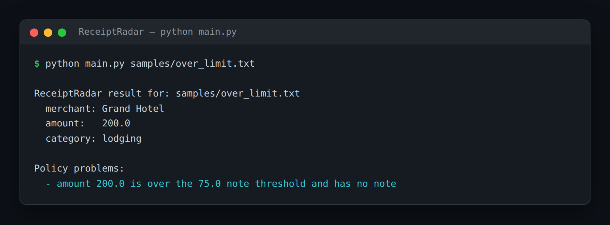

# ReceiptRadar — Expense-Receipt Extraction & Policy Check

> **Short description:** A pipeline that reads an expense receipt (`.txt`, `.md`, or `.pdf`), extracts merchant/amount/category into a typed `Receipt` with `with_structured_output`, then enforces the company's expense **policy** with deterministic rules — an amount over the note-threshold needs a note, banned categories are never reimbursable — and returns the receipt plus any policy problems.

**Tech:** Python · LangChain · `langchain-community` document loaders · OpenAI SDK · Pydantic  ·  **Type:** Document pipeline (load → extract → check policy → report)  ·  **Level:** Intermediate

## Demo



```
$ python main.py samples/over_limit.txt

ReceiptRadar result for: samples/over_limit.txt
  merchant: Grand Hotel
  amount:   200.0
  category: lodging

Policy problems:
  - amount 200.0 is over the 75.0 note threshold and has no note
```

## Overview

This is the practice twin of [InvoiceIQ](../project_14_invoiceiq_document_extraction/) — the same load → extract → validate shape, pointed at expense reports. Every company that reimburses expenses reads each receipt and checks it against a policy; ReceiptRadar does both.

- A **loader** reads the receipt file into text (Doc08's document loaders).
- An **extractor** turns it into a typed `Receipt` (merchant, amount, category, whether a note is attached) with `with_structured_output`.
- A **policy validator** enforces the real rules deterministically — over-limit needs a note, banned categories are rejected, required fields present.
- A **reporter** returns the receipt plus any policy problems — empty means approved.

## Why

A company policy is exactly the kind of rule you must never trust an LLM to apply consistently — one run approves a $200 no-note receipt, the next rejects a valid $12 meal. Write the policy as plain Python and it's right every time. The model reads the messy receipt; your code enforces the rules. The same shape fits insurance claims, loan checks, and any "extract then enforce policy" job.

## Features

- Reads `.txt`, `.md`, and `.pdf` receipts with LangChain document loaders.
- Typed extraction via `model.with_structured_output(Receipt)` — no hand-parsing.
- Deterministic policy: over-threshold-no-note and banned categories always caught.
- One clean result: the receipt plus a human-readable list of policy problems.
- The policy validator is testable with hand-made objects — no model or key.

## Architecture

```
receipt file (.txt / .pdf)
   |
   load_receipt_text(path)        document loader -> plain text
   |
   extract_receipt(model, text)   with_structured_output(Receipt) -> typed obj
   |
   check_policy(receipt)          threshold/note, banned category -> problems
   |
   process_receipt -> Result      the Receipt + any policy problems (empty = ok)
```

## Project Structure

```
<repo folder>/ (the ReceiptRadar repo — full name in the heading above)
├── samples/
│   ├── approved.txt            a small, in-policy receipt
│   ├── banned_category.txt     an alcohol charge
│   └── over_limit.txt          over the note threshold, no note
├── src/
│   ├── models/llm.py
│   ├── utils/logger.py
│   ├── config.py
│   ├── exceptions.py
│   ├── loader.py               load_receipt_text()
│   ├── pipeline.py             process_receipt(), Result
│   ├── policy.py               check_policy()
│   └── schemas.py              Receipt
├── tests/
│   ├── integration/test_live_extract.py
│   └── unit/                   test_config, test_policy
├── .env.example
├── .gitignore
├── LICENSE
├── main.py
├── README.md
└── requirements.txt
```

## Getting Started

**Requirements:** Python 3.10+ and an OpenAI API key.

```bash
git clone <this-repo-url>
cd ReceiptRadar-Expense-Receipt-Extraction-And-Policy-Check
python -m venv .venv
source .venv/bin/activate          # Windows: .venv\Scripts\activate
pip install -r requirements.txt
cp .env.example .env               # then put your key in .env
```

## Configuration

| Variable | Required | Default | Meaning |
|---|---|---|---|
| `OPENAI_API_KEY` | yes | — | Your OpenAI API key |
| `LOG_LEVEL` | no | `INFO` | Log verbosity |

## Usage

```bash
python main.py samples/approved.txt      # approved
python main.py samples/over_limit.txt    # flags the missing note
```

## Running the Tests

```bash
# unit — no model, no network
python -m tests.unit.test_config
python -m tests.unit.test_policy

# integration — real model
python -m tests.integration.test_live_extract
```

## Error Handling

| Situation | What happens |
|---|---|
| `OPENAI_API_KEY` missing | Stops at startup with one clear line |
| Over-threshold with no note | Reported as a policy problem |
| A banned category | Reported as a policy problem |
| An unsupported file type | A clear error from the loader |

## Design Decisions

- **Policy is code, not a prompt.** Thresholds and banned lists are plain Python, so the same receipt gets the same decision every time.
- **The model reads; the policy decides.** Extraction is the model's job; approval is the validator's.
- **The policy validator is deterministic** — testable with hand-made receipts, no model or key.

## License

MIT — see `LICENSE`.
