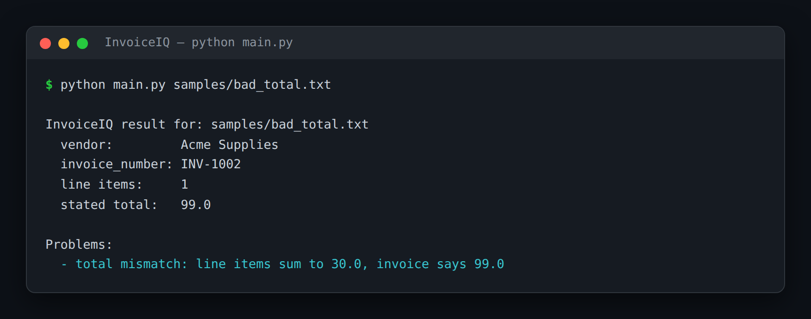

# InvoiceIQ — PDF Invoice Data Extraction & Validation

> **Short description:** A small pipeline that reads an invoice file (`.txt`, `.md`, or `.pdf`), extracts the fields that matter into a typed `Invoice` object with `with_structured_output`, then runs deterministic checks — do the line items add up to the stated total? is a required field missing? — and returns the data plus any problems. The model reads; your code checks.

**Tech:** Python · LangChain · `langchain-community` document loaders · OpenAI SDK · Pydantic  ·  **Type:** Document pipeline (load → extract → validate → report)  ·  **Level:** Intermediate

## Demo



```
$ python main.py samples/bad_total.txt

InvoiceIQ result for: samples/bad_total.txt
  vendor:         Acme Supplies
  invoice_number: INV-1002
  line items:     1
  stated total:   99.0

Problems:
  - total mismatch: line items sum to 30.0, invoice says 99.0
```

## Overview

Finance teams get invoices as PDFs and text files, each laid out differently, and someone has to key the numbers in and catch the ones that don't add up. InvoiceIQ does the reading and the checking.

- A **loader** reads the file into text (Doc08's document loaders — PDFs included).
- An **extractor** turns the text into a typed `Invoice` with `with_structured_output`, so the shape is guaranteed.
- A **validator** runs deterministic rules the model can't be trusted with (totals add up; required fields present).
- A **reporter** returns the data plus a list of problems — empty means "cleared to post."

## Why

An LLM is excellent at reading a messy document into a clean shape and untrustworthy with the result. The value is the pairing: extract with the model, verify with code the model never runs. That exact split — model reads, code checks — is what makes any document-AI system (receipts, contracts, forms, lab reports, resumes) safe to actually act on.

## Features

- Reads `.txt`, `.md`, and `.pdf` invoices with LangChain document loaders.
- Guaranteed-shape extraction via `model.with_structured_output(Invoice)` — no hand-parsing.
- Deterministic validation: a total that doesn't match the line items is always caught.
- One clean result: the typed data plus a human-readable list of problems.
- The validator is testable with hand-made objects — no model or API key needed.

## Architecture

```
invoice file (.txt / .pdf)
   |
   load_invoice_text(path)        document loader -> plain text
   |
   extract_invoice(model, text)   with_structured_output(Invoice) -> typed obj
   |
   validate_invoice(invoice)      sum(qty*price) vs total; fields -> problems
   |
   process_invoice -> Result      the Invoice + any problems (empty = cleared)
```

## Project Structure

```
<repo folder>/ (the InvoiceIQ repo — full name in the heading above)
├── samples/
│   ├── clean.txt               a correct invoice
│   ├── bad_total.txt           line items don't sum to the total
│   └── missing_number.txt      no invoice number
├── src/
│   ├── __init__.py
│   ├── config.py
│   ├── exceptions.py
│   ├── loader.py               load_invoice_text()
│   ├── models/llm.py           get_model()
│   ├── pipeline.py             process_invoice(), Result
│   ├── schemas.py              Invoice, LineItem
│   ├── utils/logger.py
│   └── validator.py            validate_invoice()
├── tests/
│   ├── integration/test_live_extract.py
│   └── unit/                   test_config, test_validator
├── .env.example
├── .gitignore
├── LICENSE
├── main.py
├── README.md
└── requirements.txt
```

## Getting Started

**Requirements:** Python 3.10+ and an OpenAI API key.

```bash
git clone <this-repo-url>
cd InvoiceIQ-PDF-Invoice-Data-Extraction-And-Validation
python -m venv .venv
source .venv/bin/activate          # Windows: .venv\Scripts\activate
pip install -r requirements.txt
cp .env.example .env               # then put your key in .env
```

## Configuration

| Variable | Required | Default | Meaning |
|---|---|---|---|
| `OPENAI_API_KEY` | yes | — | Your OpenAI API key |
| `LOG_LEVEL` | no | `INFO` | Log verbosity |

## Usage

```bash
python main.py samples/clean.txt         # cleared
python main.py samples/bad_total.txt     # flags a total mismatch
```

## Running the Tests

```bash
# unit — no model, no network
python -m tests.unit.test_config
python -m tests.unit.test_validator

# integration — real model
python -m tests.integration.test_live_extract
```

## Error Handling

| Situation | What happens |
|---|---|
| `OPENAI_API_KEY` missing | Stops at startup with one clear line |
| The total doesn't add up | Reported as a problem, not silently accepted |
| A required field is blank | Reported as a problem |
| An unsupported file type | A clear error from the loader |

## Design Decisions

- **The model reads; code checks.** Extraction is the model's job; trust is the validator's. Never let the model's own "looks right" be the final word on a number.
- **Structured output, not JSON prompting.** `with_structured_output(Invoice)` guarantees the shape, so there's nothing to hand-parse and no "please reply as JSON."
- **The validator is deterministic** — plain arithmetic over the typed object — so it's fully testable with hand-made invoices, no model or key.

## License

MIT — see `LICENSE`.
