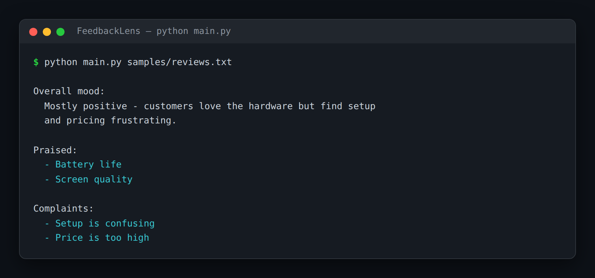

# FeedbackLens — Customer-Feedback Batch Analyzer

> **Short description:** Paste in a batch of customer reviews and get back three things — what people praise, what people complain about, and the overall mood — produced by three specialist chains run in parallel and folded into one report by a deterministic compiler.

**Tech:** Python · LangChain (LCEL, `RunnableParallel`) · OpenAI SDK · Pydantic  ·  **Type:** Multi-agent (3 parallel extractors + a compiler)  ·  **Level:** Intermediate

## Demo



```
$ python main.py samples/reviews.txt

Overall mood:
  Mostly positive — customers love the hardware but find setup and
  pricing frustrating.

Praised:
  - Battery life
  - Screen quality

Complaints:
  - Setup is confusing
  - Price is too high
```

## Overview

This is the practice twin of [MeetingMind](../project_15_meetingmind_transcript_intelligence/) — the same parallel-extract-and-compile shape, pointed at customer feedback. A product team collects reviews nobody has time to read; FeedbackLens pulls out the signal.

- A **praises extractor** returns a typed list of liked features.
- A **complaints extractor** returns a typed list of raised problems.
- A **sentiment summarizer** returns a few sentences on the mood.
- The three run **in parallel** (`RunnableParallel`), and a deterministic **compiler** folds them into one `FeedbackReport`.

## Why

"Analyze this pile of feedback" is really *several narrow extractions*, not one giant prompt that does each part badly. One specialist per job, typed outputs for the lists, parallel because they're independent, deterministic compile — the simplest, most useful form of the supervisor-of-specialists pattern. The same shape fits survey responses, support tickets, interview notes, and app-store comments.

## Features

- Three specialist chains, each one narrow job.
- Typed output for praises and complaints; plain text for the mood summary.
- The three run concurrently with `RunnableParallel`.
- A deterministic compiler/formatter, testable with hand-made parts (no model, no key).

## Architecture

```
batch of reviews
   |
   RunnableParallel(            <- all three run at the same time
       summary    = summary chain,
       praises    = praises chain (structured),
       complaints = complaints chain (structured),
   )
   |
   compile_report(parts)   ->   FeedbackReport(summary, praises, complaints)
   |
   format_report(report)   ->   the printed block
```

## Project Structure

```
<repo folder>/ (the FeedbackLens repo — full name in the heading above)
├── samples/reviews.txt
├── src/
│   ├── agents/                 praises.py, complaints.py, summary.py
│   ├── models/llm.py
│   ├── utils/logger.py
│   ├── config.py
│   ├── exceptions.py
│   ├── pipeline.py             run_analysis(), RunnableParallel
│   ├── report.py               compile_report(), format_report()
│   └── schemas.py              Praises, Complaints, FeedbackReport
├── tests/
│   ├── integration/test_live_analysis.py
│   └── unit/                   test_config, test_report
├── .env.example
├── .gitignore
├── LICENSE
├── main.py
├── README.md
└── requirements.txt
```

## Getting Started

**Requirements:** Python 3.10+ and an OpenAI API key.

```bash
git clone <this-repo-url>
cd FeedbackLens-Customer-Feedback-Batch-Analyzer
python -m venv .venv
source .venv/bin/activate          # Windows: .venv\Scripts\activate
pip install -r requirements.txt
cp .env.example .env               # then put your key in .env
```

## Configuration

| Variable | Required | Default | Meaning |
|---|---|---|---|
| `OPENAI_API_KEY` | yes | — | Your OpenAI API key |
| `LOG_LEVEL` | no | `INFO` | Log verbosity |

## Usage

```bash
python main.py samples/reviews.txt
```

## Running the Tests

```bash
# unit — no model, no network
python -m tests.unit.test_config
python -m tests.unit.test_report

# integration — real model
python -m tests.integration.test_live_analysis
```

## Design Decisions

- **One specialist per job.** Three narrow chains beat one giant prompt.
- **Parallel because independent.** `RunnableParallel` runs the three at once.
- **The compiler is deterministic** — formatting is plain Python, fully testable with hand-made parts.

## License

MIT — see `LICENSE`.
