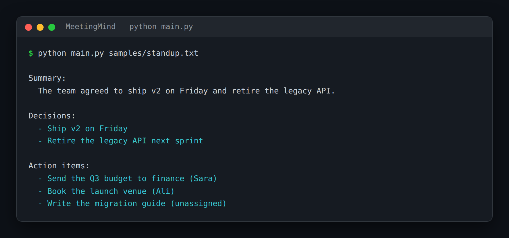

# MeetingMind — Transcript to Decisions, Actions & Summary

> **Short description:** Reads a meeting transcript and produces three things with three specialist chains run in parallel — a decisions list, an action-items list (each with an owner), and a short summary — then compiles them into one report. Each extraction is its own narrow agent; a deterministic compiler stitches the results together.

**Tech:** Python · LangChain (LCEL, `RunnableParallel`) · OpenAI SDK · Pydantic  ·  **Type:** Multi-agent (3 parallel extractors + a compiler)  ·  **Level:** Intermediate

## Demo



```
$ python main.py samples/standup.txt

Summary:
  The team agreed to ship v2 on Friday and retire the legacy API.

Decisions:
  - Ship v2 on Friday
  - Retire the legacy API next sprint

Action items:
  - Send the Q3 budget to finance (Sara)
  - Book the launch venue (Ali)
  - Write the migration guide (unassigned)
```

## Overview

After every meeting someone should write up what was decided, who's doing what, and a short recap — and usually nobody does. MeetingMind does all three from the transcript.

- An **action-item extractor** returns a typed list of `{task, owner}`.
- A **decisions extractor** returns a typed list of decisions.
- A **summarizer** returns a few sentences.
- The three run **in parallel** (`RunnableParallel`) because none depends on the others, and a deterministic **compiler** folds them into one `MeetingReport`.

## Why

A lot of "AI for meetings" is really *several narrow extractions*, not one giant prompt that tries to do everything and does each part badly. Give each job its own specialist and its own typed shape, run the independent ones at the same time, and compile — the simplest, most useful form of the supervisor-of-specialists pattern behind every larger multi-agent system.

## Features

- Three specialist chains, each with one job and one prompt.
- Typed output for decisions and actions (`with_structured_output`); plain text for the summary.
- The three run concurrently with `RunnableParallel` — faster than one after another.
- A deterministic compiler/formatter, testable with hand-made parts (no model, no key).
- An action item with no named owner reads "unassigned", never blank.

## Architecture

```
transcript
   |
   RunnableParallel(            <- all three run at the same time
       summary   = summarize chain,
       decisions = decisions chain (structured),
       actions   = actions chain (structured),
   )
   |
   compile_report(parts)   ->   MeetingReport(summary, decisions, action_items)
   |
   format_report(report)   ->   the printed block
```

## Project Structure

```
<repo folder>/ (the MeetingMind repo — full name in the heading above)
├── samples/standup.txt
├── src/
│   ├── agents/                 actions.py, decisions.py, summary.py
│   ├── models/llm.py
│   ├── utils/logger.py
│   ├── config.py
│   ├── exceptions.py
│   ├── pipeline.py             run_meeting(), RunnableParallel
│   ├── report.py               compile_report(), format_report()
│   └── schemas.py              ActionItem, Decisions, MeetingReport
├── tests/
│   ├── integration/test_live_meeting.py
│   └── unit/                   test_config, test_report
├── .env.example
├── .gitignore
├── LICENSE
├── main.py
├── README.md
└── requirements.txt
```

## Getting Started

**Requirements:** Python 3.10+ and an OpenAI API key.

```bash
git clone <this-repo-url>
cd MeetingMind-Transcript-To-Decisions-Actions-And-Summary
python -m venv .venv
source .venv/bin/activate          # Windows: .venv\Scripts\activate
pip install -r requirements.txt
cp .env.example .env               # then put your key in .env
```

## Configuration

| Variable | Required | Default | Meaning |
|---|---|---|---|
| `OPENAI_API_KEY` | yes | — | Your OpenAI API key |
| `LOG_LEVEL` | no | `INFO` | Log verbosity |

## Usage

```bash
python main.py samples/standup.txt
```

## Running the Tests

```bash
# unit — no model, no network
python -m tests.unit.test_config
python -m tests.unit.test_report

# integration — real model
python -m tests.integration.test_live_meeting
```

## Design Decisions

- **One specialist per job.** Three narrow chains beat one giant prompt that does each part badly.
- **Parallel because they're independent.** `RunnableParallel` runs the three at once; the compiler needs all three, so there's nothing to serialize.
- **The compiler is deterministic** — formatting is plain Python, fully testable with hand-made parts, no model.

## License

MIT — see `LICENSE`.
