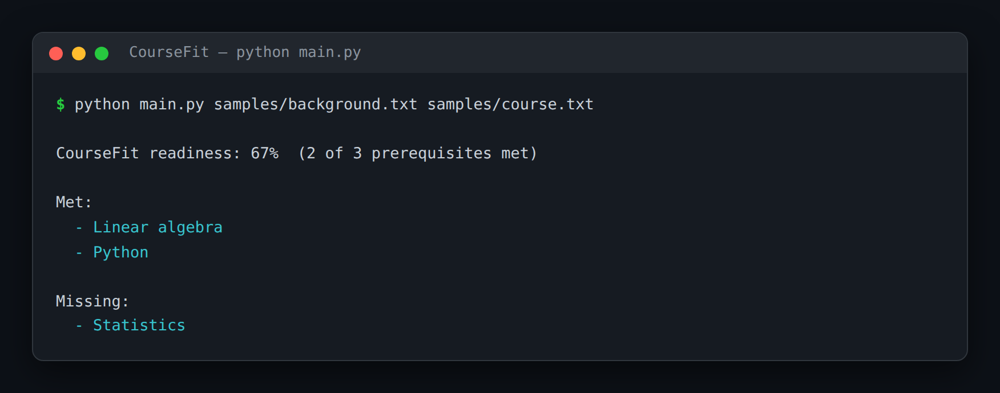

# CourseFit — Course Prerequisite Readiness Checker

> **Short description:** Checks whether a student is ready for a course by matching their background against the course's prerequisites — by *meaning*, with RAG. It extracts the required prerequisites, indexes the student's background, and searches it semantically for each one, so "MATH 221: Matrices and Vectors" satisfies a "linear algebra" prerequisite. The output is a readiness score and the missing prerequisites.

**Tech:** Python · LangChain · Chroma (RAG) · OpenAI SDK · Pydantic  ·  **Type:** RAG pipeline (extract → retrieve → match → report)  ·  **Level:** Intermediate

## Demo



```
$ python main.py samples/background.txt samples/course.txt

CourseFit readiness: 67%  (2 of 3 prerequisites met)

Met:
  - Linear algebra
  - Python

Missing:
  - Statistics
```

## Overview

This is the practice twin of [JobMatch](../project_16_jobmatch_resume_jd_matcher/) — the same extract-index-match-gap shape, pointed at course readiness. A student wants an advanced course; CourseFit checks whether their background actually covers the prerequisites.

- A **prereq extractor** pulls the required prerequisites out of the course description.
- A **RAG layer** chunks the student's background, embeds it, and stores it in Chroma.
- A **matcher** searches the background semantically for each prerequisite: close enough is met, otherwise it's a gap.
- A deterministic step turns met/unmet into a **readiness score** and the **missing prerequisites**.

## Why

Matching by meaning is a RAG problem, not a string problem. "Matrices and Vectors" should satisfy a "linear algebra" prerequisite, and a keyword check can't see that. The score engine stays deterministic (a distance below a cutoff is a match), so the whole decision is testable with no model. The same shape fits onboarding readiness, certification checks, and loan eligibility.

## Features

- Semantic prerequisite matching via RAG — robust to different wording.
- Typed prereq extraction from the course description (`with_structured_output`).
- A deterministic engine that takes a `distance` function — fully testable with no model.
- A readiness **score** plus the exact **missing prerequisites**.

## Architecture

```
course + student background
   |
   extract_required_prereqs(model, course)  -> typed list of prereqs
   build_background_store(background)        -> chunks embedded in Chroma
   |
   for each prereq:
       best_distance(collection, prereq)    -> how far the closest chunk is
       distance <= cutoff ? met : missing
   |
   check_prereqs -> ReadinessReport(score, met, missing)
```

## Project Structure

```
<repo folder>/ (the CourseFit repo — full name in the heading above)
├── samples/                    background.txt, course.txt
├── src/
│   ├── models/llm.py
│   ├── rag/                    background_store.py, retriever.py
│   ├── utils/logger.py
│   ├── config.py
│   ├── exceptions.py
│   ├── extractor.py            extract_required_prereqs()
│   ├── matcher.py              check_prereqs()
│   ├── pipeline.py             run_check()
│   └── schemas.py              RequiredPrereqs, ReadinessReport
├── tests/
│   ├── integration/test_live_check.py
│   └── unit/                   test_config, test_matcher
├── .env.example
├── .gitignore
├── LICENSE
├── main.py
├── README.md
└── requirements.txt
```

## Getting Started

**Requirements:** Python 3.10+ and an OpenAI API key.

```bash
git clone <this-repo-url>
cd CourseFit-Course-Prerequisite-Readiness-Checker
python -m venv .venv
source .venv/bin/activate          # Windows: .venv\Scripts\activate
pip install -r requirements.txt
cp .env.example .env               # then put your key in .env
```

## Configuration

| Variable | Required | Default | Meaning |
|---|---|---|---|
| `OPENAI_API_KEY` | yes | — | Your OpenAI API key |
| `LOG_LEVEL` | no | `INFO` | Log verbosity |
| `MATCH_CUTOFF` | no | `0.8` | Max distance that still counts as met |

## Usage

```bash
python main.py samples/background.txt samples/course.txt
```

## Running the Tests

```bash
# unit — no model, no embeddings
python -m tests.unit.test_config
python -m tests.unit.test_matcher

# integration — real model + embeddings
python -m tests.integration.test_live_check
```

## Design Decisions

- **Matching is semantic, not string.** RAG lets a differently-worded prereq still match — the whole reason this beats a keyword filter.
- **The engine takes a `distance` function.** The decision is deterministic and testable with made-up distances, no model or embeddings.
- **The report names the gaps.** A student wants to know *what* to brush up on, not just a percentage.

## License

MIT — see `LICENSE`.
