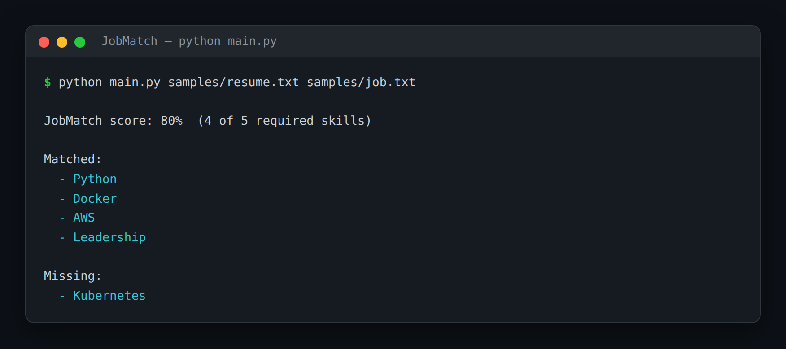

# JobMatch — Resume to Job-Description Skill Matcher

> **Short description:** Matches a resume against a job description by *meaning*, not keywords. It extracts the required skills from the posting, indexes the resume with RAG, and searches the resume semantically for each skill — so "built REST APIs in Python" matches a "Python" requirement. The output is a match score and the exact missing skills.

**Tech:** Python · LangChain · Chroma (RAG) · `langchain-community` loaders · OpenAI SDK · Pydantic  ·  **Type:** RAG pipeline (extract → retrieve → match → report)  ·  **Level:** Intermediate

## Demo



```
$ python main.py samples/resume.txt samples/job.txt

JobMatch score: 80%  (4 of 5 required skills)

Matched:
  - Python
  - Docker
  - AWS
  - Leadership

Missing:
  - Kubernetes
```

## Overview

A recruiter with one job description and a stack of resumes spends real time on "does this person fit?" — and a keyword search misses "JS" when the posting says "JavaScript". JobMatch answers it by meaning.

- A **skill extractor** pulls the required skills out of the job description (typed list).
- A **RAG layer** chunks the resume, embeds it, and stores it in Chroma.
- A **matcher** searches the resume semantically for each required skill: close enough (distance below a cutoff) is matched, otherwise it's a gap.
- A deterministic step turns matched/missing into a **score** and the **missing skills**.

## Why

Matching by meaning is a RAG problem, not a string problem. "Built REST APIs in Python" should satisfy a "Python" requirement, and a keyword check can't see that — a semantic search can. The matcher stays deterministic (a distance below a cutoff is a match), so the whole decision is testable with no model. The same shape fits matching candidates to roles, tickets to experts, or questions to documents.

## Features

- Semantic skill matching via RAG — robust to different wording.
- Typed skill extraction from the job description (`with_structured_output`).
- A deterministic matcher that takes a `distance` function — fully testable with no model or embeddings.
- A match **score** plus the exact **missing skills**, not just a number.
- A tunable `MATCH_CUTOFF` so you can trade precision for recall.

## Architecture

```
resume + job description
   |
   extract_required_skills(model, job)   -> typed list of skills
   build_resume_store(resume)            -> chunks embedded in Chroma
   |
   for each required skill:
       best_distance(collection, skill)  -> how far the closest resume chunk is
       distance <= cutoff ? matched : missing
   |
   match_skills -> MatchReport(score, matched, missing)
```

## Project Structure

```
<repo folder>/ (the JobMatch repo — full name in the heading above)
├── samples/                    resume.txt, job.txt
├── src/
│   ├── models/llm.py
│   ├── rag/                    resume_store.py, retriever.py
│   ├── utils/logger.py
│   ├── config.py
│   ├── exceptions.py
│   ├── extractor.py            extract_required_skills()
│   ├── matcher.py              match_skills()
│   ├── pipeline.py             run_match()
│   └── schemas.py              RequiredSkills, MatchReport
├── tests/
│   ├── integration/test_live_match.py
│   └── unit/                   test_config, test_matcher
├── .env.example
├── .gitignore
├── LICENSE
├── main.py
├── README.md
└── requirements.txt
```

## Getting Started

**Requirements:** Python 3.10+ and an OpenAI API key.

```bash
git clone <this-repo-url>
cd JobMatch-Resume-To-Job-Description-Skill-Matcher
python -m venv .venv
source .venv/bin/activate          # Windows: .venv\Scripts\activate
pip install -r requirements.txt
cp .env.example .env               # then put your key in .env
```

## Configuration

| Variable | Required | Default | Meaning |
|---|---|---|---|
| `OPENAI_API_KEY` | yes | — | Your OpenAI API key |
| `LOG_LEVEL` | no | `INFO` | Log verbosity |
| `MATCH_CUTOFF` | no | `0.8` | Max distance that still counts as a match |

## Usage

```bash
python main.py samples/resume.txt samples/job.txt
```

## Running the Tests

```bash
# unit — no model, no embeddings
python -m tests.unit.test_config
python -m tests.unit.test_matcher

# integration — real model + embeddings
python -m tests.integration.test_live_match
```

## Design Decisions

- **Matching is semantic, not string.** RAG lets a differently-worded skill still match — the whole reason this beats a keyword filter.
- **The matcher takes a `distance` function.** The decision engine is deterministic and testable with made-up distances, no model or embeddings.
- **The report names the gaps.** A recruiter wants the missing skills, not just a percentage.

## License

MIT — see `LICENSE`.
