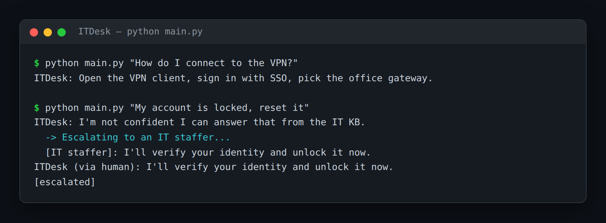

# ITDesk — IT Helpdesk Bot With Human Escalation

> **Short description:** An internal IT helpdesk bot that answers routine questions (VPN, software installs, printers) from the IT knowledge base, and **escalates the sensitive ones** — account lockouts, security incidents — to a human by pausing the conversation with LangGraph's `interrupt()` until an IT staffer replies. It answers only when the KB match is confident.

**Tech:** Python · LangChain · Chroma (RAG) · LangGraph (`interrupt`, checkpointer) · OpenAI SDK  ·  **Type:** RAG agent with human-in-the-loop  ·  **Level:** Intermediate

## Demo



```
$ python main.py "How do I connect to the VPN?"
ITDesk: Open the VPN client, sign in with your SSO, and pick the office
gateway. (from the IT KB)

$ python main.py "My account is locked, reset it"
ITDesk: I'm not confident I can answer that from the IT knowledge base.
  -> Escalating to an IT staffer...
  [IT staffer]: I'll verify your identity and unlock the account now.
ITDesk (via human): I'll verify your identity and unlock the account now.
[escalated]
```

## Overview

This is the practice twin of [DeflectDesk](../project_17_deflectdesk_rag_escalation/) — the same confidence-gate-plus-human-handoff shape, pointed at an IT helpdesk, where auto-answering the wrong request is a security risk.

- A **retrieve** node searches the IT KB and records the best match's distance.
- A **router** checks it against a cutoff: close enough → answer; too far → escalate.
- The **answer** node replies grounded in the matched KB article.
- The **escalate** node calls `interrupt()`, pausing the graph until a human replies; a checkpointer saves the state so the pause can last.

## Why

Any assistant that touches sensitive actions — IT, finance, healthcare — needs the same guardrail: answer the routine, hand off the risky. A confidence gate (a retrieval distance under a cutoff) plus a real `interrupt`-based handoff is what stops a bot from auto-"resetting" an account it should never touch.

## Features

- RAG over the IT knowledge base, with a tunable confidence cutoff.
- Answers only when the best match is close enough — never guesses on sensitive requests.
- Real human-in-the-loop: `interrupt()` pauses the graph; a human reply resumes it.
- A checkpointer saves the paused state, so an IT staffer can answer later.
- The confidence gate is deterministic and testable with no model.

## Architecture

```
question
   |
   retrieve (search IT KB)  ->  best_distance, context
   |
   is_confident(best_distance)?
        yes -> answer node (grounded in the KB article) -> END
        no  -> escalate node -> interrupt() PAUSES the graph
                                   ... an IT staffer replies ...
                                 resume -> answer = human reply -> END
```

## Project Structure

```
<repo folder>/ (the ITDesk repo — full name in the heading above)
├── data/kb/                    short .md IT knowledge-base articles
├── src/
│   ├── models/llm.py
│   ├── rag/                    kb_store.py, retriever.py
│   ├── utils/logger.py
│   ├── config.py
│   ├── confidence.py           is_confident()
│   ├── exceptions.py
│   ├── graph.py                build_graph()
│   └── state.py                SupportState, start_state()
├── tests/
│   ├── integration/test_live_support.py
│   └── unit/                   test_config, test_confidence
├── .env.example
├── .gitignore
├── LICENSE
├── main.py
├── README.md
└── requirements.txt
```

## Getting Started

**Requirements:** Python 3.10+ and an OpenAI API key.

```bash
git clone <this-repo-url>
cd ITDesk-IT-Helpdesk-Bot-With-Human-Escalation
python -m venv .venv
source .venv/bin/activate          # Windows: .venv\Scripts\activate
pip install -r requirements.txt
cp .env.example .env               # then put your key in .env
```

## Configuration

| Variable | Required | Default | Meaning |
|---|---|---|---|
| `OPENAI_API_KEY` | yes | — | Your OpenAI API key |
| `LOG_LEVEL` | no | `INFO` | Log verbosity |
| `CONFIDENCE_CUTOFF` | no | `0.8` | Max distance that still counts as confident |

## Usage

```bash
python main.py "How do I connect to the VPN?"   # answered from the KB
python main.py "My account is locked"           # escalates to a human
```

## Running the Tests

```bash
# unit — no model, no network
python -m tests.unit.test_config
python -m tests.unit.test_confidence

# integration — real model + RAG + graph
python -m tests.integration.test_live_support
```

## Design Decisions

- **The confidence gate is one deterministic function** — the whole answer-or-escalate behavior, testable with no model.
- **Escalation is a real pause, not a canned message** — `interrupt()` + a checkpointer stop the graph and save its state, so a human genuinely takes over.
- **The answer node is grounded** — it answers only from the matched KB article, which the gate already confirmed is relevant.

## License

MIT — see `LICENSE`.
