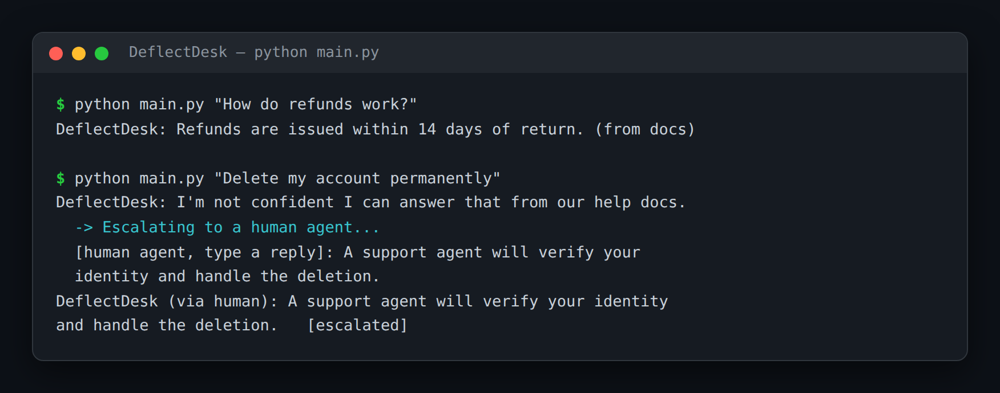

# DeflectDesk — Support Bot With Confidence-Gated Human Escalation

> **Short description:** A support bot that searches your help docs for the user's question and answers only when the best match is **confident** (a retrieval distance below a cutoff). When nothing relevant is found, it **escalates to a human** — pausing the conversation with LangGraph's `interrupt()` until a person replies — instead of inventing an answer.

**Tech:** Python · LangChain · Chroma (RAG) · LangGraph (`interrupt`, checkpointer) · OpenAI SDK  ·  **Type:** RAG agent with human-in-the-loop  ·  **Level:** Intermediate

## Demo



```
$ python main.py "How do refunds work?"
DeflectDesk: Refunds are issued within 14 days of return. (from your docs)

$ python main.py "Delete my account permanently"
DeflectDesk: I'm not confident I can answer that from our help docs.
  → Escalating to a human agent…
  [human types]: A support agent will verify your identity first.
DeflectDesk (via human): A support agent will verify your identity
first.   [escalated]
```

## Overview

Most support bots answer *everything*, confidently, including questions they shouldn't touch. DeflectDesk doesn't.

- A **retrieve** node searches the help docs and records the best match's distance.
- A **router** checks it against a cutoff: close enough → answer; too far → escalate.
- The **answer** node replies grounded in the matched doc.
- The **escalate** node calls `interrupt()`, which pauses the graph until a human replies — and a checkpointer saves the state so the pause can last.

## Why

The valuable skill isn't answering — it's knowing **when not to**. A confidence gate (a retrieval distance under a cutoff) plus a real human handoff (`interrupt` + checkpointer) is what separates a support bot you can trust from one that confidently invents a refund policy. The same shape fits any assistant that must defer to a human on the hard cases — medical intake, legal, finance.

## Features

- RAG over your help docs, with a tunable confidence cutoff.
- Answers only when the best match is close enough — never guesses off-topic.
- Real human-in-the-loop: `interrupt()` pauses the graph; a human reply resumes it.
- A checkpointer saves the paused state, so a person can answer minutes later.
- The confidence gate is deterministic and testable with no model.

## Architecture

```
question
   |
   retrieve (search help docs)  ->  best_distance, context
   |
   is_confident(best_distance)?
        yes -> answer node (grounded in the matched doc) -> END
        no  -> escalate node -> interrupt() PAUSES the graph
                                   ... a human replies ...
                                 resume -> answer = human reply -> END
```

## Project Structure

```
<repo folder>/ (the DeflectDesk repo — full name in the heading above)
├── data/help_docs/             short .md help articles
├── src/
│   ├── models/llm.py
│   ├── rag/                    help_store.py, retriever.py
│   ├── utils/logger.py
│   ├── config.py
│   ├── confidence.py           is_confident()
│   ├── exceptions.py
│   ├── graph.py                build_graph()
│   └── state.py                SupportState, start_state()
├── tests/
│   ├── integration/test_live_support.py
│   └── unit/                   test_config, test_confidence
├── .env.example
├── .gitignore
├── LICENSE
├── main.py
├── README.md
└── requirements.txt
```

## Getting Started

**Requirements:** Python 3.10+ and an OpenAI API key.

```bash
git clone <this-repo-url>
cd DeflectDesk-Support-Bot-With-Confidence-Gated-Human-Escalation
python -m venv .venv
source .venv/bin/activate          # Windows: .venv\Scripts\activate
pip install -r requirements.txt
cp .env.example .env               # then put your key in .env
```

## Configuration

| Variable | Required | Default | Meaning |
|---|---|---|---|
| `OPENAI_API_KEY` | yes | — | Your OpenAI API key |
| `LOG_LEVEL` | no | `INFO` | Log verbosity |
| `CONFIDENCE_CUTOFF` | no | `0.8` | Max distance that still counts as confident |

## Usage

```bash
python main.py "How do refunds work?"        # answered from the docs
python main.py "Delete my account"           # escalates to a human
```

## Running the Tests

```bash
# unit — no model, no network
python -m tests.unit.test_config
python -m tests.unit.test_confidence

# integration — real model + RAG + graph
python -m tests.integration.test_live_support
```

## Design Decisions

- **The confidence gate is one deterministic function.** `is_confident(distance, cutoff)` decides everything; keeping it separate makes the whole bot's behavior testable with no model.
- **Escalation is a real pause, not a canned message.** `interrupt()` + a checkpointer stop the graph and save its state, so a human genuinely takes over and the run resumes where it stopped.
- **The answer node is grounded.** It answers only from the matched document — the confidence gate already decided the document is relevant.

## License

MIT — see `LICENSE`.
