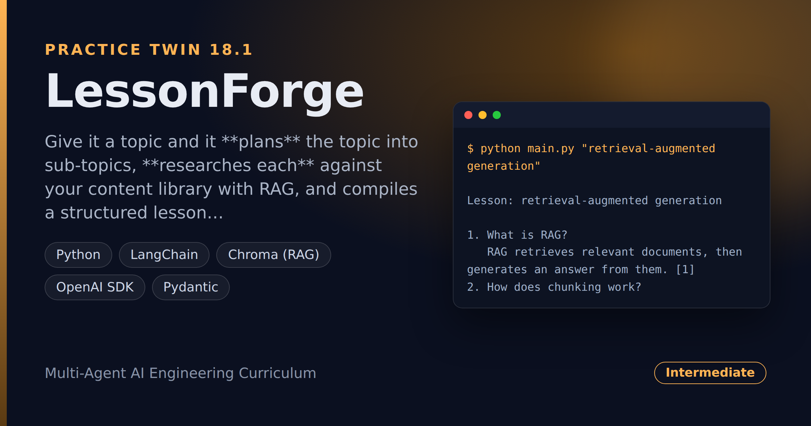

# LessonForge — Topic to Cited Lesson-Plan Builder

> **Short description:** Give it a topic and it **plans** the topic into sub-topics, **researches each** against your content library with RAG, and compiles a structured lesson plan where every section is **cited** back to its source. A plan-first agent that turns a topic plus documents into a verifiable lesson.

**Tech:** Python · LangChain · Chroma (RAG) · OpenAI SDK · Pydantic  ·  **Type:** Planner-executor agent  ·  **Level:** Intermediate

## Demo



```
$ python main.py "retrieval-augmented generation"

Lesson: retrieval-augmented generation

1. What is RAG?
   RAG retrieves relevant documents, then generates an answer from them. [1]
2. How does chunking work?
   Chunking splits a document before embedding; where you split matters. [2]
3. What is an embedding?
   Embeddings turn text into vectors so similar meanings sit close. [1]

Sources:
  [1] rag_basics.md
  [2] chunking.md
```

## Overview

This is the practice twin of [ResearchPilot](../project_18_researchpilot_planner_executor/) — the same plan-research-cite shape, pointed at building lessons. A one-shot chatbot answer is an unstructured wall of text with no sources; a lesson should be planned, grounded, and citable.

- A **planner** turns the topic into sub-topics (the lesson's sections).
- An **executor** searches your content library for each sub-topic and collects an explanation + its source.
- A **compiler** assembles the sections into a lesson with numbered citations.

## Why

A planned, cited output is **plan → research each part → compile**, and citations are what make it trustworthy. Writing the plan down first (Doc07's plan-first) makes the lesson's structure visible. The executor takes a `search` function, so the plan-and-compile engine is testable with no model or embeddings.

## Features

- Plan-first: the topic is broken into sub-topics before any search runs.
- Each section grounded in a retrieved document, with its source.
- Numbered, de-duplicated citations — the same document is `[1]` throughout.
- The engine takes a `search` function — fully testable with a fake search, no model.
- RAG over your own content library, so the lesson is grounded in your material.

## Architecture

```
topic
   |
   make_plan(model, topic)       -> [sub-topic, sub-topic, ...]
   build_library_store()         -> your content embedded in Chroma
   search = make_search(store)   -> search(q) -> (text, source)
   |
   build_sections(sub_topics, search)  -> [Section(sub_topic, text, src), ...]
   |
   compile_lesson + format_lesson  ->  lesson with numbered citations
```

## Project Structure

```
<repo folder>/ (the LessonForge repo — full name in the heading above)
├── data/library/               .md content documents
├── src/
│   ├── models/llm.py
│   ├── rag/                    library_store.py, search.py
│   ├── utils/logger.py
│   ├── config.py
│   ├── exceptions.py
│   ├── builder.py              build_sections()
│   ├── planner.py              make_plan()
│   ├── pipeline.py             run_lesson()
│   ├── lesson.py               compile_lesson(), format_lesson()
│   └── schemas.py              SubTopics, Section, Lesson
├── tests/
│   ├── integration/test_live_lesson.py
│   └── unit/                   test_config, test_lesson
├── .env.example
├── .gitignore
├── LICENSE
├── main.py
├── README.md
└── requirements.txt
```

## Getting Started

**Requirements:** Python 3.10+ and an OpenAI API key.

```bash
git clone <this-repo-url>
cd LessonForge-Topic-To-Cited-Lesson-Plan-Builder
python -m venv .venv
source .venv/bin/activate          # Windows: .venv\Scripts\activate
pip install -r requirements.txt
cp .env.example .env               # then put your key in .env
```

## Configuration

| Variable | Required | Default | Meaning |
|---|---|---|---|
| `OPENAI_API_KEY` | yes | — | Your OpenAI API key |
| `LOG_LEVEL` | no | `INFO` | Log verbosity |

## Usage

```bash
python main.py "retrieval-augmented generation"
```

## Running the Tests

```bash
# unit — no model, no embeddings
python -m tests.unit.test_config
python -m tests.unit.test_lesson

# integration — real model + RAG
python -m tests.integration.test_live_lesson
```

## Design Decisions

- **Plan first, then research.** The sub-topics are written down before any search, so the lesson's structure is visible (Doc07's plan-first).
- **The executor takes a `search` function.** Injecting the search keeps the plan-and-compile engine deterministic and testable with no model.
- **Citations, numbered and de-duplicated.** Every section points to its source; the same document keeps one number.

## License

MIT — see `LICENSE`.
