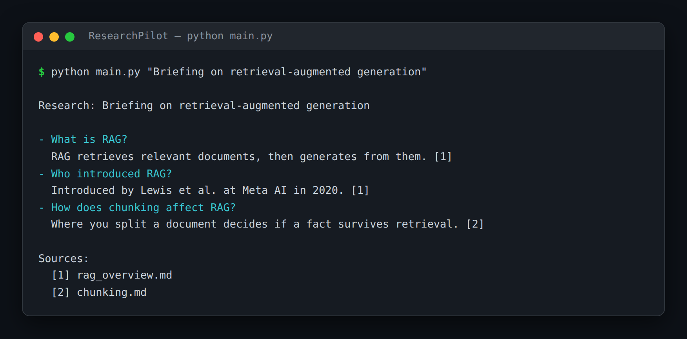

# ResearchPilot — Planner-Executor Research Agent With Cited Reports

> **Short description:** Ask a broad question and the agent **plans** it into focused sub-questions, **researches each one** against your documents with RAG, and writes a report where every claim is **cited** back to its source. A plan-first agent whose answer you can actually verify.

**Tech:** Python · LangChain · Chroma (RAG) · OpenAI SDK · Pydantic  ·  **Type:** Planner-executor agent  ·  **Level:** Intermediate

## Demo



```
$ python main.py "Give me a briefing on retrieval-augmented generation"

Research: Give me a briefing on retrieval-augmented generation

- What is RAG?
  RAG retrieves relevant documents, then generates an answer from them. [1]
- Who introduced RAG?
  Lewis et al. at Meta AI introduced RAG in 2020. [1]
- How does chunking affect RAG?
  Where you split a document decides whether a fact survives retrieval. [2]

Sources:
  [1] rag_overview.md
  [2] chunking.md
```

## Overview

A single RAG call answers a single question. "Give me a briefing on X" is really several questions, and the answer should say *where each part came from*. ResearchPilot does both.

- A **planner** turns the broad question into a short list of focused sub-questions.
- An **executor** searches your documents for each sub-question and collects a finding (the retrieved text + its source).
- A **compiler** assembles the findings into a report with numbered citations, de-duplicating sources.

## Why

A research agent is **plan → execute each step → compile**, and what makes it *trustworthy* is citations — every claim points to the document it came from, so a reader can check it. Writing the plan down before anything runs (Doc07's plan-first) makes the whole process reviewable. The executor takes a `search` function, so the plan-and-compile engine is testable with no model or embeddings.

## Features

- Plan-first: the question is broken into sub-questions before any search runs.
- Each finding is grounded in a retrieved document, with its source.
- Numbered, de-duplicated citations — the same document is `[1]` throughout.
- The engine takes a `search` function — fully testable with a fake search, no model.
- RAG over your own documents, so the report is grounded in your material.

## Architecture

```
broad question
   |
   make_plan(model, question)   -> [sub-question, sub-question, ...]
   build_source_store()         -> your documents embedded in Chroma
   search = make_search(store)  -> search(q) -> (text, source)
   |
   execute_plan(sub_questions, search)  -> [Finding(sub_q, text, source), ...]
   |
   compile_report + format_report  ->  report with numbered citations
```

## Project Structure

```
<repo folder>/ (the ResearchPilot repo — full name in the heading above)
├── data/sources/               .md documents to research over
├── src/
│   ├── models/llm.py
│   ├── rag/                    source_store.py, search.py
│   ├── utils/logger.py
│   ├── config.py
│   ├── exceptions.py
│   ├── executor.py             execute_plan()
│   ├── planner.py              make_plan()
│   ├── pipeline.py             run_research()
│   ├── report.py               compile_report(), format_report()
│   └── schemas.py              SubQuestions, Finding, Report
├── tests/
│   ├── integration/test_live_research.py
│   └── unit/                   test_config, test_report
├── .env.example
├── .gitignore
├── LICENSE
├── main.py
├── README.md
└── requirements.txt
```

## Getting Started

**Requirements:** Python 3.10+ and an OpenAI API key.

```bash
git clone <this-repo-url>
cd ResearchPilot-Planner-Executor-Research-Agent-With-Cited-Reports
python -m venv .venv
source .venv/bin/activate          # Windows: .venv\Scripts\activate
pip install -r requirements.txt
cp .env.example .env               # then put your key in .env
```

## Configuration

| Variable | Required | Default | Meaning |
|---|---|---|---|
| `OPENAI_API_KEY` | yes | — | Your OpenAI API key |
| `LOG_LEVEL` | no | `INFO` | Log verbosity |

## Usage

```bash
python main.py "Give me a briefing on retrieval-augmented generation"
```

## Running the Tests

```bash
# unit — no model, no embeddings
python -m tests.unit.test_config
python -m tests.unit.test_report

# integration — real model + RAG
python -m tests.integration.test_live_research
```

## Design Decisions

- **Plan first, then execute.** The sub-questions are written down before any search, so the research path is visible and reviewable (Doc07's plan-first).
- **The executor takes a `search` function.** Injecting the search keeps the plan-and-compile engine deterministic and testable with no model or embeddings.
- **Citations, numbered and de-duplicated.** Every claim points to its source; the same document keeps one number — so a reader can verify the report.

## License

MIT — see `LICENSE`.
