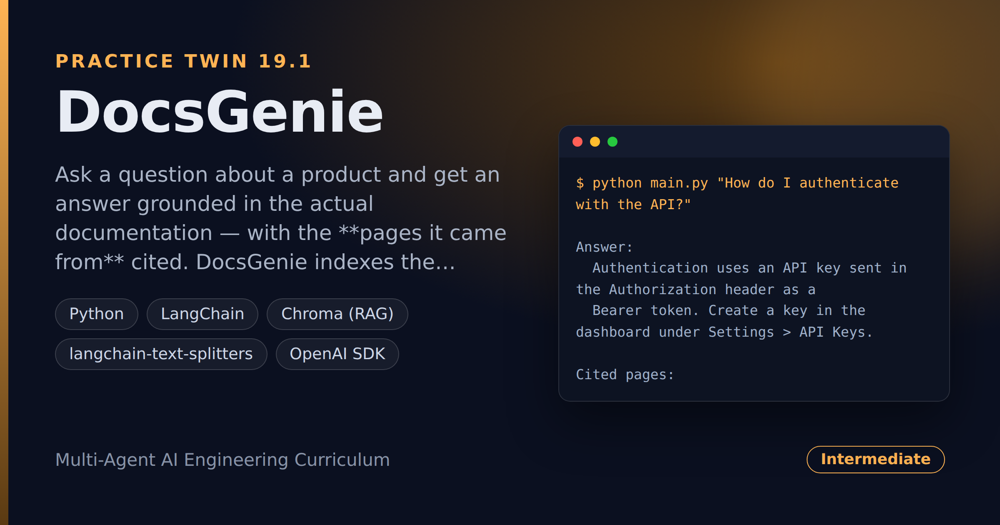

# DocsGenie — Product-Documentation Q&A With Source-Page Citations

> **Short description:** Ask a question about a product and get an answer grounded in the actual documentation — with the **pages it came from** cited. DocsGenie indexes the product's `.md` doc pages with RAG, retrieves the passages most relevant to your question, and has the model answer *only* from those passages, so the answer is correct for *this* product and you can jump straight to the source page.

**Tech:** Python · LangChain · Chroma (RAG) · `langchain-text-splitters` · OpenAI SDK  ·  **Type:** RAG Q&A over documents  ·  **Level:** Intermediate

## Demo



```
$ python main.py "How do I authenticate with the API?"

Answer:
  Authentication uses an API key sent in the Authorization header as a
  Bearer token. Create a key in the dashboard under Settings > API Keys.

Cited pages:
  - authentication.md
```

## Overview

This is the practice twin of [RepoSage](../project_19_reposage_codebase_qa/) — the same RAG-over-files shape, pointed at product documentation. A general chatbot answers from how products *usually* work, with no source to check; DocsGenie answers from the product's own docs and cites the page.

- The product's doc pages are chunked, embedded, and stored in Chroma, each chunk remembering its **page name**.
- A **retriever** pulls the passages closest to the question.
- A deterministic **context builder** stitches them into one block with `# Page:` headers and collects the unique pages for citations.
- The **answer** step has the model answer *only* from that context, and the result names the cited pages.

## Why

A documentation assistant is RAG with one twist — the "documents" are doc pages, and the **citation is a page name** you can open. Grounding the answer in retrieved docs (not the model's training memory) is what makes it correct for *your* product. The context builder and citation list are deterministic, so they test with no model or embeddings.

## Features

- RAG over a docs folder, with each chunk tied to its page.
- Answers grounded in the actual documentation — "I don't know" when the docs don't cover it.
- Page citations, de-duplicated — jump straight to the source page.
- The context + citation builders are deterministic, testable with no model.

## Architecture

```
question
   |
   build_docs_store(docs)        -> .md chunks in Chroma (page in metadata)
   retrieve_passages(q)          -> [{text, page}, ...]
   |
   build_context(passages)       -> one block with "# Page: name" headers
   cited_pages(passages)         -> unique page names
   |
   answer_question(model, q, context)  ->  grounded answer + cited pages
```

## Project Structure

```
<repo folder>/ (the DocsGenie repo — full name in the heading above)
├── docs/                        a tiny set of .md doc pages to index
├── src/
│   ├── models/llm.py
│   ├── rag/                     docs_store.py, retriever.py
│   ├── utils/logger.py
│   ├── answer.py                answer_question()
│   ├── config.py
│   ├── context.py               build_context(), cited_pages()
│   ├── exceptions.py
│   └── pipeline.py              run_query()
├── tests/
│   ├── integration/test_live_query.py
│   └── unit/                    test_config, test_context
├── .env.example
├── .gitignore
├── LICENSE
├── main.py
├── README.md
└── requirements.txt
```

## Getting Started

**Requirements:** Python 3.10+ and an OpenAI API key.

```bash
git clone <this-repo-url>
cd DocsGenie-Product-Documentation-Q-And-A-With-Source-Page-Citations
python -m venv .venv
source .venv/bin/activate          # Windows: .venv\Scripts\activate
pip install -r requirements.txt
cp .env.example .env               # then put your key in .env
```

## Configuration

| Variable | Required | Default | Meaning |
|---|---|---|---|
| `OPENAI_API_KEY` | yes | — | Your OpenAI API key |
| `LOG_LEVEL` | no | `INFO` | Log verbosity |
| `DOCS_DIR` | no | `docs` | The documentation folder to index |

## Usage

```bash
python main.py "How do I authenticate with the API?"
```

## Running the Tests

```bash
# unit — no model, no embeddings
python -m tests.unit.test_config
python -m tests.unit.test_context

# integration — real model + RAG
python -m tests.integration.test_live_query
```

## Design Decisions

- **Each chunk keeps its page name.** The page name *is* the citation — no page, no "jump to source".
- **The answer is grounded in retrieved docs.** The model answers only from the passages, so it's right for this product, and says "I don't know" when the docs don't cover the question.
- **The context + citation builders are deterministic.** Passages in, formatted context + page list out — fully testable with hand-made passages, no model.

## License

MIT — see `LICENSE`.
