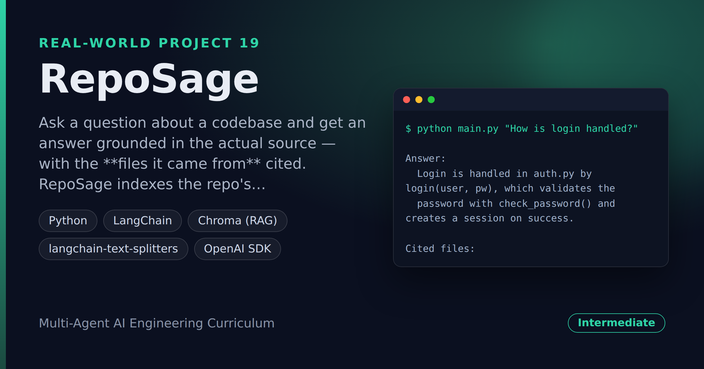

# RepoSage — Codebase Q&A Assistant With File Citations

> **Short description:** Ask a question about a codebase and get an answer grounded in the actual source — with the **files it came from** cited. RepoSage indexes the repo's `.py` files with RAG, retrieves the snippets most relevant to your question, and has the model answer *only* from those snippets, so the answer is correct for *this* codebase and you can jump straight to the source.

**Tech:** Python · LangChain · Chroma (RAG) · `langchain-text-splitters` · OpenAI SDK  ·  **Type:** RAG Q&A over code  ·  **Level:** Intermediate

## Demo



```
$ python main.py "How is login handled?"

Answer:
  Login is handled in auth.py by login(user, pw), which validates the
  password with check_password() and creates a session on success.

Cited files:
  - auth.py
  - session.py
```

## Overview

Dropping into an unfamiliar repo, the first hour is grepping and guessing. RepoSage answers questions about the code from the code itself.

- The repo's source files are chunked, embedded, and stored in Chroma, each chunk remembering its **file path**.
- A **retriever** pulls the snippets closest to the question.
- A deterministic **context builder** stitches them into one block with `# File:` headers and collects the unique files for citations.
- The **answer** step has the model answer *only* from that context, and the result names the cited files.

## Why

A codebase assistant is RAG with one twist — the "documents" are code, and the **citation is a file path** you can open. Grounding the answer in retrieved code (not the model's training memory) is what makes it correct for *your* repo. The context builder and citation list are deterministic, so they test with no model or embeddings.

## Features

- RAG over a codebase, with each chunk tied to its file.
- Answers grounded in the actual source — "I don't know" when the code doesn't cover it.
- File citations, de-duplicated — jump straight to the source.
- The context + citation builders are deterministic, testable with no model.

## Architecture

```
question
   |
   build_code_store(repo)        -> .py chunks in Chroma (file in metadata)
   retrieve_snippets(q)          -> [{code, file}, ...]
   |
   build_context(snippets)       -> one block with "# File: path" headers
   cited_files(snippets)         -> unique file paths
   |
   answer_question(model, q, context)  ->  grounded answer + cited files
```

## Project Structure

```
<repo folder>/ (the RepoSage repo — full name in the heading above)
├── sample_repo/                a tiny codebase to index
├── src/
│   ├── models/llm.py
│   ├── rag/                    code_store.py, retriever.py
│   ├── utils/logger.py
│   ├── answer.py               answer_question()
│   ├── config.py
│   ├── context.py              build_context(), cited_files()
│   ├── exceptions.py
│   └── pipeline.py             run_query()
├── tests/
│   ├── integration/test_live_query.py
│   └── unit/                   test_config, test_context
├── .env.example
├── .gitignore
├── LICENSE
├── main.py
├── README.md
└── requirements.txt
```

## Getting Started

**Requirements:** Python 3.10+ and an OpenAI API key.

```bash
git clone <this-repo-url>
cd RepoSage-Codebase-Q-And-A-Assistant-With-File-Citations
python -m venv .venv
source .venv/bin/activate          # Windows: .venv\Scripts\activate
pip install -r requirements.txt
cp .env.example .env               # then put your key in .env
```

## Configuration

| Variable | Required | Default | Meaning |
|---|---|---|---|
| `OPENAI_API_KEY` | yes | — | Your OpenAI API key |
| `LOG_LEVEL` | no | `INFO` | Log verbosity |
| `REPO_DIR` | no | `sample_repo` | The codebase to index |

## Usage

```bash
python main.py "How is login handled?"
```

## Running the Tests

```bash
# unit — no model, no embeddings
python -m tests.unit.test_config
python -m tests.unit.test_context

# integration — real model + RAG
python -m tests.integration.test_live_query
```

## Design Decisions

- **Each chunk keeps its file path.** The file path *is* the citation — no path, no "jump to source".
- **The answer is grounded in retrieved code.** The model answers only from the snippets, so it's right for this repo, and says "I don't know" when the code doesn't cover the question.
- **The context + citation builders are deterministic.** Snippets in, formatted context + file list out — fully testable with hand-made snippets, no model.

## License

MIT — see `LICENSE`.
