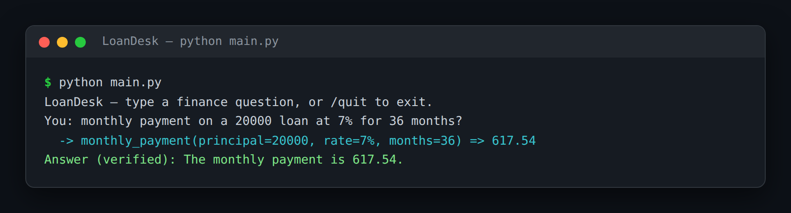

# LoanDesk — Tool-Using Finance Assistant With a Verifier

> **Short description:** A finance-desk assistant built as two agents. A tool-using **Worker** answers money questions by calling real tools — an exact loan-payment calculator, a live exchange-rate lookup, and a policy search — in a hand-built loop with a hard step limit. A separate **Verifier** checks the answer against what the tools actually returned before it reaches the user.

**Tech:** Python · LangChain (LCEL + `@tool`) · a hand-built agent loop · Pydantic  ·  **Type:** Multi-agent (Worker + Verifier)  ·  **Level:** Beginner–Intermediate

## Overview

A model states a wrong number as confidently as a right one — not good enough when the number is a loan payment. LoanDesk answers by **acting**, then **checking**:

- The **Worker** runs a think→act→observe loop over three tools: `monthly_payment` (exact amortization math), `get_exchange_rate` (today's real rate), `search_policies` (the rules). A hard limit means it can never loop forever, and a tool that fails is retried, not crashed on.
- The **Verifier** is a second agent with its own prompt. It reads the question, the answer, and only the **successful** tool results, and returns a checked `approved`/`reason` verdict. A rejected answer gets exactly one retry.

## Why

Any assistant that must answer with live or exact information — a price, a rate, a balance, a policy, a calculation — needs to look it up instead of guessing, and (when it touches money) have a second check before it acts. That's a tool-using worker plus an independent verifier. The hand-built loop is the building block of every bigger agent; building it yourself means you understand it.

## Features

- Hand-built ReAct loop (no `create_agent`/`AgentExecutor`) with a step log and a hard `max_iterations`.
- Three tools: pure-logic calculator, a **live keyless API** (frankfurter.app) for FX, and a policy search that **fails on its first call** to prove recovery.
- Tool failures become clear `Error: …` observations the model can read and retry — never a crash.
- A separate `with_structured_output` Verifier fed only successful evidence.
- One retry on rejection, then the verdict (verified / NOT verified) reaches the user.

## Demo



```
$ python main.py
LoanDesk — type a finance question, or /quit to exit.
You: What is the monthly payment on a 20000 loan at 7% annual for 36 months?
  -> monthly_payment(principal=20000, rate=7%, months=36) => 617.54
Answer (verified): The monthly payment is 617.54.
```

## Architecture

```
your question
   │
   ▼
Worker loop ──► model (tools bound) ──► tool_calls? ──no──► answer
   │                                        │ yes
   │                                        ▼
   │                          run_tool (failure -> Error: observation)
   └───────────────◄────────── append result, loop (bounded by max_iterations)
                                            │
                                   AgentResult (answer + step log)
                                            │
                                            ▼
Verifier ──► checks answer vs. SUCCESSFUL tool evidence ──► approved? 
                                            │ no -> one retry of the Worker
                                            ▼
                              verified / NOT verified -> user
```

## Project Structure

```
<repo folder>/   (LoanDesk-Tool-Using-Finance-Assistant-With-A-Verifier/)
├── data/sample/tasks.json
├── scripts/compare_with_tools.py   guess vs. checked answer
├── src/
│   ├── agents/
│   │   ├── __init__.py
│   │   ├── verifier.py       build chain, collect_evidence(), verify()
│   │   └── worker.py         run_worker(), find_tool(), run_tool(), AgentResult
│   ├── chains/
│   │   ├── __init__.py
│   │   └── direct_answer.py  build_direct_chain() — no tools
│   ├── models/
│   │   ├── __init__.py
│   │   └── llm.py            get_model()
│   ├── prompts/
│   │   ├── direct.txt
│   │   ├── verifier.txt
│   │   └── worker.txt
│   ├── services/
│   │   ├── __init__.py
│   │   └── finance_service.py answer_task(): Worker -> Verifier -> one retry
│   ├── tools/
│   │   ├── __init__.py
│   │   ├── calculator.py     monthly_payment (pure logic)
│   │   ├── fx.py             get_exchange_rate (live API)
│   │   └── policy_search.py  search_policies (fails on 1st call)
│   ├── utils/
│   │   ├── __init__.py
│   │   ├── http_client.py    request_with_retry()
│   │   ├── logger.py
│   │   └── prompts.py
│   ├── __init__.py
│   ├── config.py
│   ├── exceptions.py
│   └── schemas.py            VerifierVerdict
├── tests/
│   ├── integration/
│   │   └── test_live_agents.py
│   └── unit/
│       ├── test_agents.py
│       ├── test_config.py
│       └── test_tools.py
├── .env.example
├── .gitignore
├── LICENSE
├── main.py
├── README.md
└── requirements.txt
```

## Getting Started

**Requirements:** Python 3.10+ and an OpenAI API key. The FX tool uses the keyless frankfurter.app — no extra setup.

```bash
git clone <this-repo-url>
cd LoanDesk-Tool-Using-Finance-Assistant-With-A-Verifier
python -m venv .venv
source .venv/bin/activate          # Windows: .venv\Scripts\activate
pip install -r requirements.txt
cp .env.example .env               # then put your key in .env
```

## Configuration

| Variable | Required | Default | Meaning |
|---|---|---|---|
| `OPENAI_API_KEY` | yes | — | Your OpenAI API key |
| `LOG_LEVEL` | no | `INFO` | Log verbosity |

## Usage

```bash
python main.py
# or, to see a guess next to a checked answer:
python -m scripts.compare_with_tools
```

## Running the Tests

```bash
# unit — no API key, no network
python -m tests.unit.test_config
python -m tests.unit.test_tools
python -m tests.unit.test_agents

# integration — real model + the FX API
python -m tests.integration.test_live_agents
```

## Error Handling

| Situation | What happens |
|---|---|
| `OPENAI_API_KEY` missing | Stops at startup with one clear line |
| A tool fails mid-task | A clear `Error: …` observation goes back to the model, which retries |
| The model loops without finishing | `MaxIterationsExceeded` with the partial step log |
| Answer not grounded in evidence | The Verifier rejects it; one retry, then it's marked NOT verified |

## Design Decisions

- **The loop is hand-built** — you can see every think→act→observe turn, which is the point of the project.
- **The Verifier is separate** — a model checking its own work shares the blind spots that made the mistake; a second prompt catches more.
- **Only successful tool results become evidence** — a failed call never "supports" an answer.

## License

MIT — see `LICENSE`.
