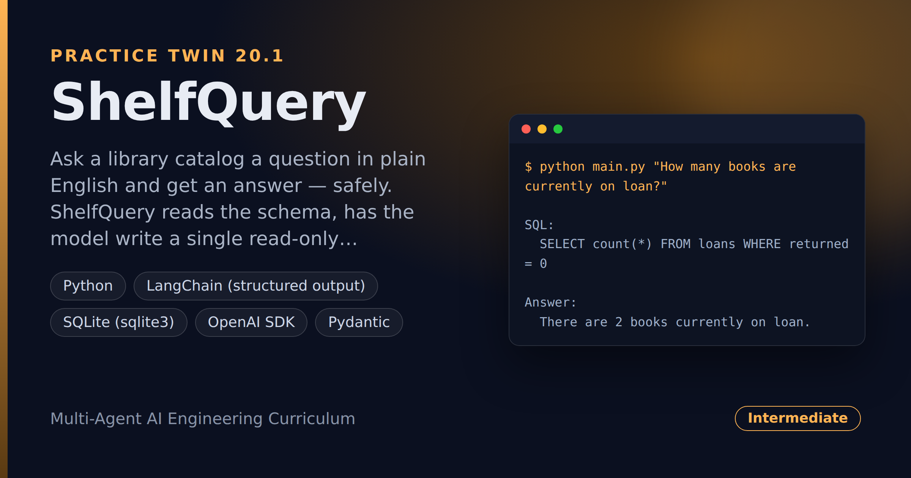

# ShelfQuery — Library-Catalog Q&A in Plain English (Read-Only SQL)

> **Short description:** Ask a library catalog a question in plain English and get an answer — safely. ShelfQuery reads the schema, has the model write a single read-only `SELECT` as **structured output**, checks it with a **deterministic guard** (no `INSERT`/`UPDATE`/`DELETE`/`DROP`/chained statements), runs it against SQLite, and phrases the result in one sentence. The catalog is read, never changed.

**Tech:** Python · LangChain (structured output) · SQLite (`sqlite3`) · OpenAI SDK · Pydantic  ·  **Type:** NL-to-SQL analytics agent  ·  **Level:** Intermediate

## Demo



```
$ python main.py "How many books are currently on loan?"

SQL:
  SELECT count(*) FROM loans WHERE returned = 0

Answer:
  There are 2 books currently on loan.
```

## Overview

This is the practice twin of [SQLSage](../project_20_sqlsage_nl_to_sql_agent/) — the same NL-to-SQL-with-a-guard shape, pointed at a library catalog, which is the library's system of record and must never be changed by a bot.

- The catalog **schema** is read and handed to the model as context.
- The model returns a single read-only `SELECT` as **structured output**.
- A deterministic **guard** rejects anything that isn't a safe single `SELECT`.
- The **runner** executes the query; the **answer** step phrases the rows.

## Why

Letting a model write SQL is powerful and dangerous — and against a system of record, dangerous is not acceptable. The safety is a **deterministic guard**, not a hope: a plain-Python check that runs before any query touches the catalog. The guard and the runner need no model, so they test with hand-written SQL and a tiny in-memory database.

## Features

- Plain-English questions answered from a real SQLite catalog.
- SQL returned as structured output — a clean query string, not prose.
- A deterministic safety guard: single read-only `SELECT` only.
- An unsafe generated query raises `UnsafeQueryError` and never runs.
- Grounded answers phrased from the returned rows.

## Architecture

```
question
   |
   schema_text(db)                 -> the CREATE TABLE statements
   generate_sql(model, schema, q)  -> a single SELECT (structured output)
   |
   is_safe_select(sql)             -> True / False  (deterministic guard)
   run_select(db, sql)             -> rows
   |
   summarize_answer(model, q, rows)  ->  one-sentence answer
```

## Project Structure

```
<repo folder>/ (the ShelfQuery repo — full name in the heading above)
├── data/                        the SQLite catalog (built by seed)
├── src/
│   ├── models/llm.py
│   ├── db/                      seed.py, schema.py, runner.py
│   ├── utils/logger.py
│   ├── guard.py                 is_safe_select()
│   ├── schemas.py               SQLQuery
│   ├── sql_agent.py             generate_sql()
│   ├── answer.py                summarize_answer()
│   ├── config.py
│   ├── exceptions.py
│   └── pipeline.py              ask()
├── tests/
│   ├── integration/test_live_ask.py
│   └── unit/                    test_config, test_guard, test_db
├── .env.example
├── .gitignore
├── LICENSE
├── main.py
├── README.md
└── requirements.txt
```

## Getting Started

**Requirements:** Python 3.10+ and an OpenAI API key.

```bash
git clone <this-repo-url>
cd ShelfQuery-Library-Catalog-Q-And-A-In-Plain-English
python -m venv .venv
source .venv/bin/activate          # Windows: .venv\Scripts\activate
pip install -r requirements.txt
cp .env.example .env               # then put your key in .env
```

## Configuration

| Variable | Required | Default | Meaning |
|---|---|---|---|
| `OPENAI_API_KEY` | yes | — | Your OpenAI API key |
| `LOG_LEVEL` | no | `INFO` | Log verbosity |
| `DB_PATH` | no | `data/library.db` | The SQLite catalog to query |

## Usage

```bash
python main.py "How many books are currently on loan?"
```

## Running the Tests

```bash
# unit — no model
python -m tests.unit.test_config
python -m tests.unit.test_guard
python -m tests.unit.test_db

# integration — real model
python -m tests.integration.test_live_ask
```

## Design Decisions

- **The guard is deterministic.** An LLM can write anything; a plain-Python check — `SELECT`-only, no write/schema keyword, single statement — decides what runs, and it tests with no model.
- **SQL comes back as structured output.** A Pydantic `SQLQuery` gives a clean query string, not prose to parse.
- **The answer is grounded in the rows.** The model phrases only what the query returned, and says "no matching data" when the rows are empty.

## License

MIT — see `LICENSE`.
