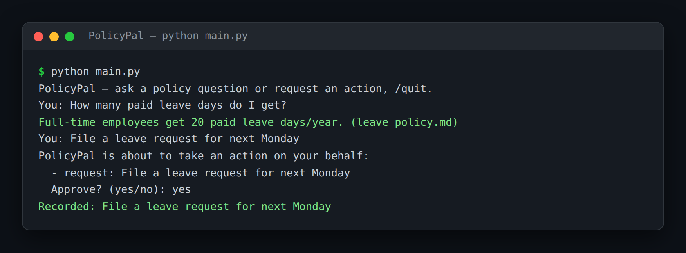

# PolicyPal — HR Policy Assistant With Citations & Approval

> **Short description:** An HR assistant on a LangGraph graph. It **retrieves** policy passages before answering, **grounds** every answer with a citation to the source file, says **"not in the HR policies"** instead of guessing, and **pauses for a human to approve** any consequential action — with the paused state saved, so a separate run can finish it.

**Tech:** Python · LangGraph (+ SQLite checkpointer) · LangChain · Chroma · Pydantic  ·  **Type:** RAG agent (3 roles) with human-in-the-loop  ·  **Level:** Intermediate

## Overview

An assistant people trust with real policies and real actions has to do two things a careless one doesn't: ground every answer in retrieved evidence it can cite, and never take a consequential action without a human in the loop. PolicyPal does both.

- **Retriever role** — routes question-vs-action, searches the policy collection, and keeps only passages close enough to be relevant (by embedding **distance**). Nothing relevant → "not found".
- **Reasoner role** — answers from the retrieved passages only, citing the source file; refuses cleanly when nothing was retrieved.
- **Approval role** — for an action, builds a checklist and calls `interrupt()` to pause; a human resumes with yes/no. The saved state means the approval can come from a different process.

## Why

Every assistant that sits on a company's own documents and can *do* things — HR bots, IT helpdesks, support agents over a knowledge base — needs these two habits. Grounding-with-citations stops it inventing a policy; the human-approval pause stops it quietly acting on someone's behalf. The saved-state pause is how real systems hand an approval to a person who may be on another machine, later.

## Features

- RAG over the HR docs: paragraph chunking, a Chroma collection built once, `retrieve()` returning passages with **source** and **distance**.
- A distance cutoff that turns "nothing close enough" into an honest "not found".
- Routing (question vs action) done **in code**, so it's testable with no model.
- Grounded, cited answers; a clean refusal when the docs don't cover the question.
- A `interrupt()` approval gate with a SQLite checkpointer — pause in one run, resume (yes/no) in another.

## Demo



```
$ python main.py
PolicyPal — ask a policy question or request an action, /quit.
You: How many paid leave days do I get?
Full-time employees receive 20 paid leave days per year. (leave_policy.md)
You: What's the Berlin office wifi password?
That isn't covered in the HR policies.
You: File a leave request for next Monday
PolicyPal is about to take an action on your behalf:
  - request: File a leave request for next Monday
  Approve? (yes/no)
Approve (yes/no): yes
Recorded: File a leave request for next Monday
```

## Architecture

```
START -> retrieve -> classify_kind + search
              |
   question   |   action
              v
  reason                      approval
   - grounded, cited           - build checklist
   - no passages -> not found  - interrupt()  <- PAUSE (state saved)
              |                      |
              v              human resumes yes/no (maybe another run)
             END             yes -> recorded / no -> cancelled -> END
```

## Project Structure

```
<repo folder>/   (PolicyPal-HR-Policy-Assistant-With-Citations-And-Approval/)
├── data/
│   ├── policies/
│   │   ├── leave_policy.md
│   │   └── remote_policy.md
│   ├── pause_demo.py          start an action run, stop at the pause
│   └── resume_demo.py         a separate process approves and finishes it
├── src/
│   ├── agents/
│   │   ├── __init__.py
│   │   ├── approval_agent.py  build_checklist()
│   │   ├── reasoner_agent.py  answer_grounded()
│   │   └── retriever_agent.py classify_kind(), search(), MAX_DISTANCE
│   ├── models/
│   │   ├── __init__.py
│   │   └── llm.py
│   ├── prompts/
│   │   ├── reasoner.txt
│   │   └── router.txt
│   ├── rag/
│   │   ├── __init__.py
│   │   ├── chunking.py
│   │   ├── ingest.py          build_vector_store()
│   │   ├── retriever.py       retrieve() -> list[dict]
│   │   └── store.py           get_collection()
│   ├── utils/
│   │   ├── __init__.py
│   │   ├── logger.py
│   │   └── prompts.py
│   ├── __init__.py
│   ├── config.py
│   ├── exceptions.py
│   ├── graph.py               build_graph(model, collection, checkpointer)
│   └── state.py               DocState, start_state()
├── tests/
│   ├── integration/
│   │   └── test_live_graph.py
│   └── unit/
│       ├── test_approval_checks.py
│       ├── test_chunking.py
│       ├── test_config.py
│       ├── test_retrieval.py
│       └── test_routing.py
├── .env.example
├── .gitignore
├── LICENSE
├── main.py
├── README.md
└── requirements.txt
```

## Getting Started

**Requirements:** Python 3.10+ and an OpenAI API key.

```bash
git clone <this-repo-url>
cd PolicyPal-HR-Policy-Assistant-With-Citations-And-Approval
python -m venv .venv
source .venv/bin/activate          # Windows: .venv\Scripts\activate
pip install -r requirements.txt
cp .env.example .env               # then put your key in .env
```

## Configuration

| Variable | Required | Default | Meaning |
|---|---|---|---|
| `OPENAI_API_KEY` | yes | — | Your OpenAI API key |
| `LOG_LEVEL` | no | `INFO` | Log verbosity |

## Usage

```bash
python main.py
# saved-state pause across two processes:
python -m data.pause_demo      # starts an action, stops at the pause
python -m data.resume_demo     # a new process approves and finishes it
```

## Running the Tests

```bash
# unit — no API key (retrieval uses a fast offline embedding)
python -m tests.unit.test_config
python -m tests.unit.test_chunking
python -m tests.unit.test_routing
python -m tests.unit.test_retrieval
python -m tests.unit.test_approval_checks

# integration — real model
python -m tests.integration.test_live_graph
```

## Error Handling

| Situation | What happens |
|---|---|
| `OPENAI_API_KEY` missing | Stops at startup with one clear line |
| Nothing relevant retrieved | "That isn't covered in the HR policies" — no invention |
| An action is requested | The graph pauses for human approval before doing anything |
| Approval is "no" | The action is cancelled and the run says so |

## Design Decisions

- **Routing is in code, not the model** — `classify_kind` keys on action verbs, so it's deterministic and unit-testable with no API call.
- **The distance cutoff is the "not found" signal** — a passage above `MAX_DISTANCE` isn't really relevant; dropping it is how the agent stays honest.
- **State is saved by a checkpointer** — the whole point of `interrupt()` is that a human can approve later, from anywhere, not that the program blocks.

## License

MIT — see `LICENSE`.
