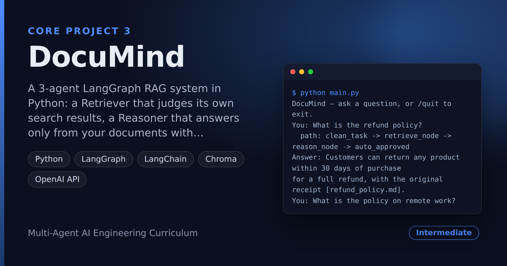

# DocuMind — Smart Document Agent: Ask Your Documents Anything, Safely

> **Short description:** A 3-agent LangGraph RAG system in Python: a Retriever that judges its own search results, a Reasoner that answers only from your documents with citations, and an Approval agent that pauses for a human only when a check fails. Saved, resumable state.

**Tech:** Python · LangGraph · LangChain · Chroma · OpenAI API · SQLite checkpoints  ·  **Type:** Multi-agent (Retriever + Reasoner + Approval)  ·  **Level:** Intermediate

## Demo



## Overview

DocuMind answers questions from **your own documents** — and only from them. A **Retriever** agent searches a local vector store and checks whether the best match is actually close enough to answer from. A **Reasoner** agent writes the answer using only the found excerpts, citing the file behind each fact. An **Approval** agent runs a checklist on every draft: safe, grounded, cited answers go straight out; anything that asks for an action, or fails a check, pauses for a person.

Everything runs as one LangGraph `StateGraph`. Its state is saved to SQLite at every step, so a run paused for approval can be finished later — even by a different process.

## Why

A model answering from its training data can sound certain about your policies and be wrong. Pasting every document into the prompt doesn't scale. And an assistant that can trigger actions shouldn't do so unchecked — but asking a person about every question means nobody uses it. DocuMind grounds answers in retrieved text, says so honestly when the documents don't cover a question, and involves a human only when a specific check fails.

## Features

- **Retrieval-augmented answers** from your own Markdown/text documents (Chroma vector store, OpenAI embeddings).
- **A written relevance bar** — the Retriever judges the best match's distance; off-topic questions get an honest "not found" instead of an answer built on nothing.
- **Search only when needed** — general questions skip retrieval and are clearly labelled as general knowledge.
- **Grounded, cited answers** — the Reasoner uses only the excerpts and names each fact's source file.
- **Checklist-based approval** — grounded? cites a source? asks for an action? All pass → auto-approved; any fail → a human decides, and sees which check failed.
- **Pause and resume** with `interrupt()` and a SQLite checkpointer — a paused run survives a restart.
- **A visible path** for every run (`clean_task -> retrieve_node -> reason_node -> auto_approved`).

## Demo

```
$ python main.py
DocuMind — ask a question, or /quit to exit.
You: What is the refund policy?
  path: clean_task -> retrieve_node -> reason_node -> auto_approved
Answer: Customers can return any product within 30 days of purchase
for a full refund, with the original receipt [refund_policy.md].
You: What is the policy on remote work?
  path: clean_task -> retrieve_node -> no_grounding_node
Answer: I couldn't find this in your documents, so I won't guess.
You: Send the warranty terms to the customer.
  -- needs your approval --
  answer: Every product has a 1-year warranty against manufacturing
faults [warranty.md].
  why:   the task asks for an action
  Approve? (yes/no): yes
  path: clean_task -> retrieve_node -> reason_node -> human_approved
Answer: Every product has a 1-year warranty against manufacturing
faults [warranty.md].
You: /quit
```

(Log lines are left out and long lines wrapped. Model replies vary.)

## Architecture

```
START -> clean_task
            │  route_search()
     ┌──────┴────────────┐
   search               skip
     ▼                   ▼
 retrieve_node       answer_node -> END
     │  has_grounding()  (general knowledge, labelled)
  ┌──┴──────────────┐
reason          no_grounding
  ▼                 ▼
reason_node     no_grounding_node -> END
  ▼                 ("not found")
approval_node -> END
  │  every check passes -> auto-approved
  └─ a check fails -> interrupt() -> human yes/no
```

- **State** (`DocState`): task, path, sources, grounded, approved, answer. `path` appends each node's name, so every run explains itself.
- **Retriever agent**: keyword routing, Chroma search, and a relevance bar on the best distance.
- **Reasoner agent**: an LCEL chain with a strict "only these excerpts, cite the file" prompt.
- **Approval agent**: three explicit checks; `interrupt()` only when one fails.
- **Checkpointer**: `SqliteSaver` in the app (`checkpoints.sqlite`), `MemorySaver` in tests — passed into `build_graph()`.

## Project Structure

```
DocuMind-Smart-Document-Agent-Ask-Your-Documents-Anything-Safely/
├── data/
│   └── docs/               the documents DocuMind answers from
│       ├── account_security.md
│       ├── pricing.md
│       ├── refund_policy.md
│       ├── shipping.md
│       └── warranty.md
├── scripts/
│   ├── pause_demo.py       part 1: start a run, stop at the pause
│   └── resume_demo.py      part 2: a new process finishes it
├── src/
│   ├── agents/
│   │   ├── __init__.py
│   │   ├── approval_agent.py  checklist + interrupt()
│   │   ├── reasoner_agent.py  grounded, cited answer
│   │   └── retriever_agent.py route, search, judge relevance
│   ├── models/
│   │   ├── __init__.py
│   │   └── llm.py          get_model() -> ChatOpenAI
│   ├── prompts/
│   │   ├── general.txt     for non-document questions
│   │   └── reasoner.txt    "only the excerpts, cite the file"
│   ├── rag/
│   │   ├── __init__.py
│   │   ├── chunking.py     chunk_by_chars/paragraph
│   │   ├── ingest.py       build_vector_store()
│   │   ├── retriever.py    retrieve() -> list[dict]
│   │   └── store.py        get_collection() — built once
│   ├── utils/
│   │   ├── __init__.py
│   │   ├── logger.py       get_logger()
│   │   └── prompts.py      load_prompt(name)
│   ├── __init__.py
│   ├── config.py           Config, load_config()
│   ├── exceptions.py       MissingConfigError
│   ├── graph.py            build_graph(checkpointer)
│   ├── nodes.py            clean_task, answer_node
│   └── state.py            DocState, start_state()
├── tests/
│   ├── integration/
│   │   └── test_live_graph.py      real API calls
│   └── unit/
│       ├── test_approval_checks.py no API key needed
│       ├── test_chunking.py        no API key needed
│       ├── test_config.py          no API key needed
│       ├── test_nodes.py           no API key needed
│       └── test_routing.py         no API key needed
├── .env                    your real key — never committed
├── .env.example            the setting names, no real values
├── .gitignore              keeps .env, .venv/, checkpoints.sqlite out
├── LICENSE                 lets others reuse your code (MIT)
├── main.py                 the terminal loop — the file you run
├── README.md               the repo's front page
└── requirements.txt        the libraries, for pip install -r
```

## Getting Started

**Requirements:** Python 3.10+ and an OpenAI API key (for chat and embeddings).

```bash
git clone <this-repo-url>
cd DocuMind-Smart-Document-Agent-Ask-Your-Documents-Anything-Safely
python -m venv .venv
source .venv/bin/activate          # Windows: .venv\Scripts\activate
pip install -r requirements.txt
cp .env.example .env               # then put your key in .env
```

## Configuration

| Variable | Required | Default | Meaning |
|---|---|---|---|
| `OPENAI_API_KEY` | yes | — | Your OpenAI API key |
| `LOG_LEVEL` | no | `INFO` | `DEBUG`, `INFO`, `WARNING` or `ERROR` |

Other settings live in code, each in one place:

| Setting | Where | Default |
|---|---|---|
| Chat model | `models/llm.py` → `MODEL_NAME` | `gpt-4o-mini` |
| Embedding model | `rag/ingest.py` → `EMBEDDING_MODEL` | `text-embedding-3-small` |
| Relevance bar | `agents/retriever_agent.py` → `MAX_DISTANCE` | `1.2` (lower = stricter) |
| Search topics | `agents/retriever_agent.py` → `SEARCH_KEYWORDS` | policy, refund, shipping, ... |
| Action words | `agents/approval_agent.py` → `ACTION_WORDS` | send, cancel, delete, ... |

**Your own documents:** put `.md` or `.txt` files in `data/docs/` — plain paragraphs, no heading lines — and update `SEARCH_KEYWORDS` to match their topics. The store is rebuilt from the folder at startup.

## Usage

Run from the repo root:

```bash
python main.py
```

To see a paused run finished by a separate process:

```bash
python -m scripts.pause_demo     # starts a run that needs approval, exits
python -m scripts.resume_demo    # a new process finds it and finishes it
```

## Running the Tests

Run from the repo root:

```bash
# unit tests — no API key, no network, under a second
python -m tests.unit.test_approval_checks
python -m tests.unit.test_chunking
python -m tests.unit.test_config
python -m tests.unit.test_nodes
python -m tests.unit.test_routing

# integration tests — real API calls, needs OPENAI_API_KEY
python -m tests.integration.test_live_graph
```

Every test case prints `OK` or `WRONG`. The unit tests check the config, the two small nodes, the chunkers, every routing and relevance rule, and the approval checklist. The integration test runs every path: a general question, an action request that pauses — approved in one run, rejected in another — a grounded answer, a question the documents don't cover, a cited answer, and a safe answer that is auto-approved.

## Error Handling

| Situation | What happens |
|---|---|
| `OPENAI_API_KEY` missing | Exits at startup with one clear line |
| Invalid API key | Caught on the first call; exits cleanly |
| Rate limit | The OpenAI client retries; then the user is asked to wait |
| Search finds nothing close enough | `no_grounding_node`: "I couldn't find this in your documents" |
| Documents don't cover the question | The Reasoner says so; the missing citation sends the answer to a human |
| Task asks for an action | The run pauses for a human, whatever the other checks say |
| App closed while a run is paused | The state is in `checkpoints.sqlite`; the run can be resumed |
| Empty `data/docs/` folder | The store is empty; every search takes the "not found" path |

## Design Decisions

- **A graph, not a loop** — state is typed, visible (`path`), saved at every step, and pausable.
- **Judge the best score, not "found something"** — a vector store always returns its k closest chunks, relevant or not.
- **Retriever and Reasoner are separate** — a wrong answer can be traced to bad search or bad writing.
- **Citations are required** — they make grounding checkable, by a person and by the Approval checklist.
- **A checklist, not one "is this okay?" call** — each check is a small function, so you can see which one fired.
- **The checkpointer is passed in** — SQLite for the app, memory for tests, no code change.
- **Nothing risky before `interrupt()`** — a node re-runs from its first line on resume.

## Limitations and Roadmap

- Search routing uses a keyword list; an LLM router would handle more wording.
- The vector store is in memory and rebuilt at startup — fine for a few documents, not thousands.
- Approved "actions" are only messages; nothing is actually sent.
- Possible next steps: a persisted vector store, an LLM relevance grader, a web UI for approvals, sending real emails after approval.

## License

MIT — see `LICENSE`.
