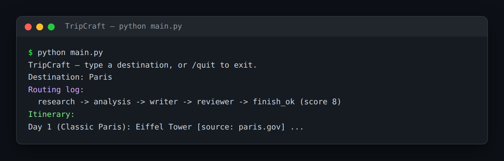

# TripCraft — Multi-Agent Travel Itinerary Generator

> **Short description:** A multi-agent team that turns a destination into a short, realistic, **sourced**, reviewed day-by-day itinerary. A Supervisor routes four specialists with LangGraph's `Command`; a Research agent looks attractions up from a local file (never from memory); a Reviewer scores the draft and sends it back until it's good enough, with a hard revision cap.

**Tech:** Python · LangGraph (`Command` routing) · LangChain · Pydantic  ·  **Type:** Multi-agent (1 Supervisor + 4 specialists)  ·  **Level:** Upper-Intermediate

## Overview

Hand TripCraft a destination — "Paris" — and it hands back a reviewed itinerary. A **Supervisor** reads a shared state and decides who works next, routing with `Command`. Four specialists each do one job:

- **Research** looks attractions up from a local `attractions.json` (each tagged with a `[source]`) — never invented.
- **Analysis** (the planner) groups the looked-up attractions into 2–4 themed days, losing none.
- **Writer** writes the itinerary from the plan only.
- **Reviewer** scores it against written criteria and sends it back with feedback — up to `MAX_REVISIONS`.

An unknown destination stops cleanly ("nothing known yet") instead of inventing attractions; a Writer and Reviewer that never agree stop with a clear "couldn't agree" report, never an endless loop.

## Why

This is the shape of any pipeline that turns one input into a reviewed, sourced document through genuinely separate phases: research → organize → draft → review. Trip planners, report generators, proposal builders, briefing tools all have it. The strict `[source]` tags and the bounded review loop are what keep an AI feature from quietly inventing facts or looping forever.

## Features

- **Supervisor + `Command` routing** — one manager decides every handoff and logs a `{step, reason}` per decision.
- **Shared state, one writer per field** — no agent overwrites another's work.
- **Tool-based research** — attractions come from a local file; an unknown destination returns nothing and stops the run.
- **Checked review verdict** — a Pydantic `ReviewVerdict` (score 1–10 + feedback); the pass mark (`PASS_SCORE`) lives in code.
- **Bounded revision loop** — `MAX_REVISIONS`, ending in an accepted itinerary or a clear "couldn't agree".
- **Sources preserved** — the itinerary keeps every `[source]` tag.

## Demo



```
$ python main.py
TripCraft — type a destination, or /quit to exit.
Destination: Paris

Routing log:
  research: no attractions looked up yet
  analysis: attractions found, need a day plan
  writer: have a plan, need an itinerary
  reviewer: have a draft, need a review
  finish_ok: accepted with score 8

Itinerary:
Day 1 (Classic Paris): Eiffel Tower [source: paris.gov] ...
...
```

## Architecture

```
START ──► supervisor ──► research ──► supervisor ──► analysis ──► supervisor
            │                                                         │
            │                                              writer ◄───┘
            │                                                │
            └──► (score >= PASS) END          reviewer ◄── supervisor
                 (revisions >= MAX) END            │
                 rejected ──► writer (revise) ◄─────┘
```

- `START → supervisor` is the **only** fixed edge. Every other move is a `Command(goto=...)` a node returns.
- The supervisor is the only writer of the routing log; it ends the run on acceptance, an unknown destination, or no agreement.

## Project Structure

```
<repo folder>/   (TripCraft-Multi-Agent-Travel-Itinerary-Generator/)
├── data/
│   └── attractions.json       destinations, [source]-tagged attractions
├── src/
│   ├── agents/
│   │   ├── __init__.py
│   │   ├── analysis_agent.py   run_analysis()
│   │   ├── research_agent.py   lookup_attractions (@tool), run_research()
│   │   ├── reviewer_agent.py   run_reviewer(), PASS_SCORE
│   │   ├── supervisor.py       decide_next(), supervisor(), MAX_REVISIONS
│   │   └── writer_agent.py     run_writer()
│   ├── models/
│   │   ├── __init__.py
│   │   └── llm.py              get_model()
│   ├── prompts/
│   │   ├── analysis.txt
│   │   ├── reviewer.txt
│   │   └── writer.txt
│   ├── utils/
│   │   ├── __init__.py
│   │   ├── logger.py
│   │   └── prompts.py
│   ├── __init__.py
│   ├── config.py
│   ├── exceptions.py
│   ├── graph.py                build_graph(): 5 nodes + supervisor, 1 edge
│   ├── schemas.py              ReviewVerdict
│   └── state.py                TeamState, start_state()
├── tests/
│   ├── integration/
│   │   └── test_live_team.py   real model
│   └── unit/
│       ├── test_config.py
│       ├── test_lookup.py
│       └── test_supervisor.py  routing on hand-made states
├── .env.example
├── .gitignore
├── LICENSE
├── main.py
├── README.md
└── requirements.txt
```

## Getting Started

**Requirements:** Python 3.10+ and an OpenAI API key.

```bash
git clone <this-repo-url>
cd TripCraft-Multi-Agent-Travel-Itinerary-Generator
python -m venv .venv
source .venv/bin/activate          # Windows: .venv\Scripts\activate
pip install -r requirements.txt
cp .env.example .env               # then put your key in .env
```

## Configuration

| Variable | Required | Default | Meaning |
|---|---|---|---|
| `OPENAI_API_KEY` | yes | — | Your OpenAI API key |
| `LOG_LEVEL` | no | `INFO` | `DEBUG`, `INFO`, `WARNING` or `ERROR` |

## Usage

```bash
python main.py
```

Type a destination in `attractions.json` (Paris, Tokyo) for a full run, or any other name to see the clean "nothing known" stop. Add your own destinations by editing `data/attractions.json`.

## Running the Tests

```bash
# unit — no API key, no network
python -m tests.unit.test_config
python -m tests.unit.test_lookup
python -m tests.unit.test_supervisor

# integration — real model
python -m tests.integration.test_live_team
```

## Error Handling

| Situation | What happens |
|---|---|
| `OPENAI_API_KEY` missing | Stops at startup with one clear line |
| Unknown destination | Research finds nothing; the team stops with "nothing known yet" |
| Writer & Reviewer never agree | Stops at `MAX_REVISIONS` with a clear "couldn't agree" report |

## Design Decisions

- **One writer per state field** — research→notes, analysis→day_plan, writer→draft, reviewer→score+feedback, supervisor→routing_log. No field has two authors, so no agent clobbers another.
- **The pass mark is in code, not the prompt** — `PASS_SCORE` and `MAX_REVISIONS` are decisions you own, not things the model can drift on.
- **Research reads a file, not memory** — the only way to guarantee the itinerary never invents an attraction.

## License

MIT — see `LICENSE`.
