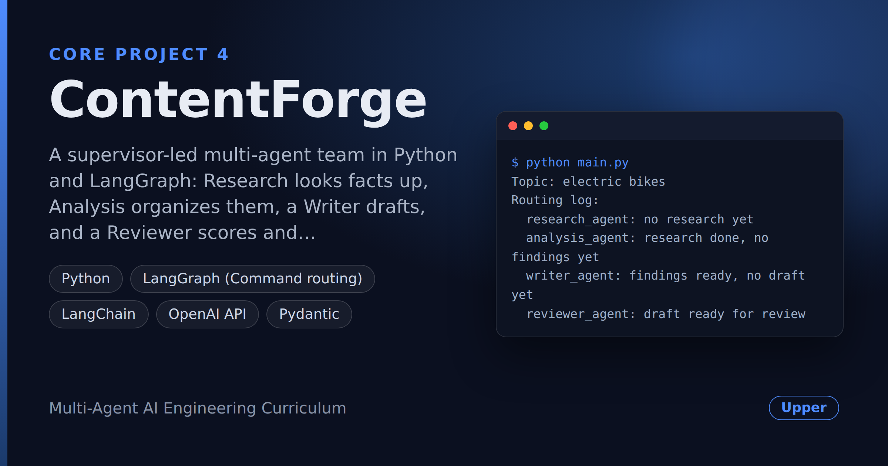

# ContentForge — Research, Write, Review Team: Turns Any Topic Into a Publish-Ready Article

> **Short description:** A supervisor-led multi-agent team in Python and LangGraph: Research looks facts up, Analysis organizes them, a Writer drafts, and a Reviewer scores and sends drafts back — with a hard revision limit and a reason logged for every routing decision.

**Tech:** Python · LangGraph (`Command` routing) · LangChain · OpenAI API · Pydantic  ·  **Type:** Multi-agent (Supervisor + 4 specialists)  ·  **Level:** Upper-Intermediate

## Demo



## Overview

ContentForge turns a topic into a short, sourced, reviewed article. A **Supervisor** agent reads a shared state and decides which specialist works next. **Research** looks facts up with a tool, **Analysis** groups them into themes without dropping any, the **Writer** drafts only from those findings, and the **Reviewer** scores the draft against written criteria — sending it back with feedback until it passes or a revision limit is reached.

Every routing decision is logged with its reason, and the routing rules are a plain function you can test without calling a model.

## Why

One prompt asked to research, organize, write and critique at once blurs all four jobs — and a wrong fact early on goes straight into the final text. Splitting the work gives each step its own narrow prompt, its own test, and a place to catch mistakes: a Reviewer that can say "not yet", and a fact trail from source to sentence.

## Features

- **Supervisor routing with `Command`** — the next step is decided at run time from the shared state.
- **A reason for every move** in the routing log (`writer_agent: revising after reviewer feedback`).
- **Tool-based research** — facts come from a lookup tool with sources, not from the model's memory.
- **No lost facts** — Analysis keeps every fact and its `[source]` tag, checked in the tests.
- **Scored review** — a checked `ReviewVerdict(score, feedback)`, with the pass mark set in code.
- **Bounded revision loop** — rejected drafts go back to the Writer with feedback, up to `MAX_REVISIONS`; then a clear "couldn't agree" report with the full feedback history.
- **Honest stop** — a topic with no known facts ends the run instead of producing an invented article.
- **One writer per state field** — no agent overwrites another's work.

## Demo

```
$ python main.py
Topic: electric bikes
Routing log:
  research_agent: no research yet
  analysis_agent: research done, no findings yet
  writer_agent: findings ready, no draft yet
  reviewer_agent: draft ready for review
  writer_agent: revising after reviewer feedback
  reviewer_agent: draft ready for review
  END: reviewer accepted the draft

Final article:

E-Bikes: How Far, How Fast, and Why Europe Loves Them

Europe sold over 5 million e-bikes in 2022 [market-report] ...
```

(Log lines are left out and the article shortened. Model output varies from run to run.)

## Architecture

```
                 ┌────────────────┐
     START ────► │   Supervisor   │ ◄──────────────────────┐
                 │ decide_next()  │                        │
                 └───────┬────────┘                        │
            Command(goto=...)                    Command(goto=
                         │                        "supervisor")
     ┌───────────────┬───┴──────────┬──────────────┐       │
     ▼               ▼              ▼              ▼       │
 Research        Analysis        Writer        Reviewer ───┘
 lookup tool     themes,         findings      score 1-10;
 + notes         keep facts      only          fail -> clear
                                               draft, add
                                               feedback
```

- **One edge** in the graph (`START → supervisor`); every other move is a `Command` returned at run time.
- **Routing policy** (`decide_next`): research → stop if nothing found → analysis → stop if accepted or at the limit → writer → reviewer.
- **Revision loop**: the Reviewer clears a rejected draft, so the Supervisor sends the work back to the Writer with the newest feedback.
- **Shared state** (`TeamState`): each field has exactly one writer; only the Supervisor writes the routing log.

## Project Structure

```
<repo folder>/   (ContentForge-Research-...-Publish-Ready-Article/)
├── data/
│   └── sample/
│       └── facts.json          the facts Research can look up
├── src/
│   ├── agents/
│   │   ├── __init__.py
│   │   ├── analysis_agent.py   run_analysis(), analysis_node
│   │   ├── research_agent.py   run_research(), research_node
│   │   ├── reviewer_agent.py   run_reviewer(), reviewer_node
│   │   ├── supervisor.py       decide_next(), supervisor()
│   │   └── writer_agent.py     run_writer(), writer_node
│   ├── models/
│   │   ├── __init__.py
│   │   └── llm.py              get_model()
│   ├── prompts/
│   │   ├── analysis.txt
│   │   ├── research.txt
│   │   ├── reviewer.txt
│   │   └── writer.txt
│   ├── tools/
│   │   ├── __init__.py
│   │   └── lookup.py           lookup_facts (@tool)
│   ├── utils/
│   │   ├── __init__.py
│   │   ├── logger.py           get_logger()
│   │   └── prompts.py          load_prompt(name)
│   ├── __init__.py
│   ├── config.py               Config, load_config()
│   ├── exceptions.py           MissingConfigError
│   ├── graph.py                build_graph(): 5 nodes, 1 edge
│   ├── schemas.py              ReviewVerdict (score, feedback)
│   └── state.py                TeamState, start_state()
├── tests/
│   ├── integration/
│   │   └── test_live_agents.py real API calls
│   └── unit/
│       ├── test_config.py      no API key needed
│       ├── test_lookup.py      no API key needed
│       └── test_supervisor.py  no API key needed
├── .env                        your real key — never committed
├── .env.example                the setting names, no real values
├── .gitignore                  keeps .env, .venv/, __pycache__/ out
├── LICENSE                     lets others reuse your code (MIT)
├── main.py                     asks for a topic, prints the report
├── README.md                   the repo's front page
└── requirements.txt            the libraries, for pip install -r
```

## Getting Started

**Requirements:** Python 3.10+ and an OpenAI API key.

```bash
git clone <this-repo-url>
# the \ joins the two lines into one folder name
cd ContentForge-Research-Write-Review-Team-Turns-Any-Topic-\
Into-A-Publish-Ready-Article
python -m venv .venv
source .venv/bin/activate          # Windows: .venv\Scripts\activate
pip install -r requirements.txt
cp .env.example .env               # then put your key in .env
```

## Configuration

| Variable | Required | Default | Meaning |
|---|---|---|---|
| `OPENAI_API_KEY` | yes | — | Your OpenAI API key |
| `LOG_LEVEL` | no | `INFO` | `DEBUG`, `INFO`, `WARNING` or `ERROR` |

| Setting | Where | Default |
|---|---|---|
| Chat model | `src/models/llm.py` → `MODEL_NAME` | `gpt-4o-mini` |
| Pass mark | `src/agents/reviewer_agent.py` → `PASS_SCORE` | `7` (out of 10) |
| Revision limit | `src/agents/supervisor.py` → `MAX_REVISIONS` | `3` |
| Known facts | `data/sample/facts.json` | electric bikes, remote work, solar panels |

To support a new topic, add it with its facts and `[source]` tags to `facts.json`.

## Usage

Run from the repo root:

```bash
python main.py
```

Enter a topic. You get the routing log and either the final article, a "couldn't agree" report with every round's feedback, or "nothing is known about this topic yet".

## Running the Tests

```bash
# unit tests — no API key
python -m tests.unit.test_config
python -m tests.unit.test_lookup
python -m tests.unit.test_supervisor

# integration tests — real API calls, needs OPENAI_API_KEY
python -m tests.integration.test_live_agents
```

The unit tests check the settings, the lookup tool and every routing rule on hand-made states. The integration test checks that the Writer keeps its sources, the Reviewer fails a weak draft, Research grounds and stops honestly, Analysis keeps every fact, and the whole team runs end to end.

## Error Handling

| Situation | What happens |
|---|---|
| `OPENAI_API_KEY` missing | Exits at startup with one clear line |
| Invalid API key | Caught; exits cleanly |
| Topic not in the fact store | Research returns nothing; the Supervisor ends the run with a clear message |
| Writer and Reviewer never agree | Stops at `MAX_REVISIONS`; prints every round's feedback and the last draft, marked NOT approved |
| Reviewer returns malformed output | Structured output is validated against `ReviewVerdict`; a bad score fails loudly |

## Design Decisions

- **A Supervisor instead of fixed edges** — the route depends on the state (nothing found, rejected draft), so it's decided at run time.
- **Routing rules as a pure function** — `decide_next()` is tested without a model or a graph.
- **The pass mark in code, not in the prompt** — the same bar on every run.
- **Clear the draft to revise** — one simple signal sends the work back to the Writer.
- **One writer per state field** — agents can't overwrite each other.
- **Each agent proven alone first** — every `run_...()` works and is tested outside the graph.
- **Cost trade-off** — several model calls per article; for very short texts one call is cheaper, but you lose review and traceability.

## Limitations and Roadmap

- Research reads a small local fact file; real web or document search would widen the topics.
- Nothing is saved between runs.
- No human approval step before publishing.
- Possible next steps: an API and a database for runs (production version), real search, an evaluation suite for article quality, a human sign-off step.

## License

MIT — see `LICENSE`.
