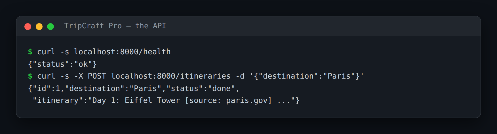

# TripCraft Pro — Production Itinerary Service (API, Database, Docker, Evals)

> **Short description:** The TripCraft itinerary team, made production-ready. A FastAPI service in front of it, a SQLite database that persists every run, a Docker image, and an evaluation suite (LLM judge + regression check) — added *around* the agents without changing a single one.

**Tech:** Python · FastAPI · SQLite · Docker · LLM-judge eval suite · LangGraph/LangChain  ·  **Type:** Production multi-agent service  ·  **Level:** Upper-Intermediate

> **Builds on [TripCraft (4.1)](../project_4.1_tripcraft_itinerary_team/)** — start from your finished itinerary team and add the production layer, exactly as Project 5 builds on Project 4.

## Overview

TripCraft (4.1) works in a terminal, on your machine, when you run it by hand — a demo. TripCraft Pro makes it a *service* others can rely on. Four pieces close the gap, and none of them touch the agents:

- **A web API (FastAPI)** — a caller `POST`s a destination to `/itineraries` and gets a run id + the itinerary as JSON; `GET /itineraries/{id}` fetches any past run; `/health` lets a monitor check it's alive.
- **A database (SQLite)** — every run is saved (destination, status, itinerary, timestamp), so "what did it produce for Tokyo last Tuesday?" is a query.
- **A Docker image** — code, deps, and start command packaged to run the same anywhere.
- **An eval suite** — a fixed set of destinations scored by an LLM judge, a pass rate, and a regression check that deliberately breaks a prompt and confirms the score drops.

## Why

The step every real AI feature must make is from "it works in a notebook" to "a team depends on it." That step is an API door, a database memory, a container box, and an eval scorecard. The eval + regression check matters most: it's how you change a prompt or model next month without quietly shipping worse output, because the scorecard fails the release first.

## Features

- One **pipeline** door (`run_pipeline`) both the API and the terminal call — the team has a single entry point.
- `POST /itineraries`, `GET /itineraries/{id}`, `GET /health`, with Pydantic request/response models.
- SQLite persistence of every run; an unknown destination is stored as a known `unknown` status, not an error.
- A `Dockerfile` that builds the service and starts uvicorn.
- An eval suite with an LLM judge, a pass rate, and a regression check that proves the suite catches a broken prompt.
- Hybrid tests: pytest for the API/judge (as Doc12/13 teach), the carried OK/WRONG scripts for the team.

## Demo



```
$ curl -s localhost:8000/health
{"status":"ok"}

$ curl -s -X POST localhost:8000/itineraries \
    -H "content-type: application/json" -d '{"destination":"Paris"}'
{"id":1,"destination":"Paris","status":"done",
 "itinerary":"Day 1: Eiffel Tower [source: paris.gov] ..."}

$ curl -s localhost:8000/itineraries/1
{"id":1,"destination":"Paris","status":"done","itinerary":"Day 1: ..."}
```

## Architecture

```
HTTP client
    |
    v
FastAPI (/health, POST /itineraries, GET /itineraries/{id})
    |                 |
    |          run_pipeline(destination)  ---> TripCraft team (4.1, unchanged)
    |                 |                          supervisor + research/analysis/
    |                 v                          writer/reviewer graph
    |          save_run() --> SQLite (runs table)
    v
JSON response (id, destination, status, itinerary)

eval suite:  run_pipeline over fixed tasks -> LLM judge -> pass rate
             regression_check: sabotage a prompt -> confirm pass rate drops
```

## Project Structure

```
<repo folder>/   (TripCraft-Pro-Production-Itinerary-Service/)
├── data/attractions.json          (from 4.1)
├── src/
│   ├── agents/                     (from 4.1, unchanged)
│   ├── models/  prompts/  utils/   (from 4.1)
│   ├── api/
│   │   ├── __init__.py
│   │   ├── main.py                 the app uvicorn starts
│   │   ├── routes.py               /health, /itineraries, /itineraries/{id}
│   │   └── schemas.py              ItineraryRequest, ItineraryResponse
│   ├── db/
│   │   ├── __init__.py
│   │   ├── database.py             init_db(), save_run(), get_run()
│   │   └── models.py               RunRecord
│   ├── evals/
│   │   ├── __init__.py
│   │   ├── judge.py                score_itinerary()
│   │   ├── regression_check.py     break a prompt, confirm the drop
│   │   ├── run_eval.py             run the suite, print a pass rate
│   │   └── tasks.py                fixed destinations + checks
│   ├── __init__.py
│   ├── config.py                   (from 4.1)
│   ├── graph.py  state.py  schemas.py   (from 4.1)
│   └── pipeline.py                 the one door into the team
├── tests/
│   ├── api/test_routes.py          the API, team faked (no key)
│   ├── evals/test_judge.py         real model
│   └── unit/                       (from 4.1)
├── .dockerignore
├── .env.example
├── .gitignore
├── Dockerfile
├── LICENSE
├── main.py                         (from 4.1 terminal app)
├── README.md
└── requirements.txt
```

## Getting Started

**Requirements:** Python 3.10+, an OpenAI API key, and your finished TripCraft (4.1) copied in (see the solution's "Start from TripCraft" step). Docker is optional.

```bash
git clone <this-repo-url>
cd TripCraft-Pro-Production-Itinerary-Service
python -m venv .venv
source .venv/bin/activate          # Windows: .venv\Scripts\activate
pip install -r requirements.txt
cp .env.example .env               # then put your key in .env
```

## Configuration

| Variable | Required | Default | Meaning |
|---|---|---|---|
| `OPENAI_API_KEY` | yes | — | Your OpenAI API key |
| `LOG_LEVEL` | no | `INFO` | Log verbosity |

## Usage

```bash
# run the API
uvicorn src.api.main:app --host 0.0.0.0 --port 8000

# or in Docker
docker build -t tripcraft-pro .
docker run -p 8000:8000 --env-file .env tripcraft-pro

# the original terminal app still works
python main.py
```

## Running the Tests

```bash
# API — team faked, no key needed
python -m pytest tests/api/test_routes.py -v

# the carried team's unit tests (no key)
python -m tests.unit.test_config
python -m tests.unit.test_lookup
python -m tests.unit.test_supervisor

# the eval suite + judge (real model)
python -m pytest tests/evals/test_judge.py -v
python -m src.evals.run_eval
python -m src.evals.regression_check
```

## Error Handling

| Situation | What happens |
|---|---|
| `OPENAI_API_KEY` missing | The pipeline/API fail fast at config load |
| Unknown destination | Stored and returned as `status: unknown` (200), not an error |
| Missing run id on GET | `404 run not found` |
| A prompt change makes output worse | The eval suite's pass rate drops; the regression check flags it |

## Design Decisions

- **One pipeline door** — the API and the terminal both call `run_pipeline`, so the agents have exactly one entry point and the web layer never reaches into the graph.
- **The agents are untouched** — productionizing is adding an API, a DB, a container, and evals *around* a working team, not rewriting it.
- **Hybrid tests by design** — pytest for the API and judge (what Doc12/13 teach), the carried OK/WRONG scripts for the team; don't convert those.

## License

MIT — see `LICENSE`.
