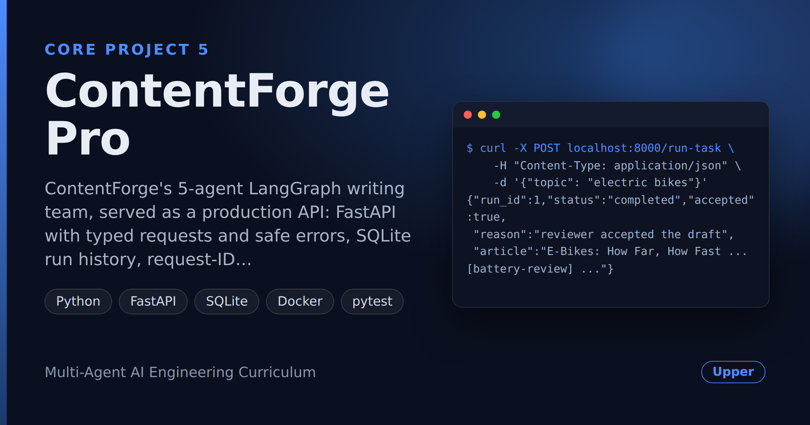

# ContentForge Pro — Production-Ready Content Pipeline With API, Database and Docker

> **Short description:** ContentForge's 5-agent LangGraph writing team, served as a production API: FastAPI with typed requests and safe errors, SQLite run history, request-ID logging, a per-caller rate limit, a Docker image with no secrets inside, API tests with a faked team, and an LLM-judge eval suite that catches prompt regressions.

**Tech:** Python · FastAPI · SQLite · Docker · pytest · LangGraph · OpenAI API  ·  **Type:** Multi-agent service (Supervisor + 4 specialists, behind an API)  ·  **Level:** Upper-Intermediate

## Demo



## Overview

ContentForge Pro turns a topic into a short, sourced, reviewed article — over HTTP. A client sends `POST /run-task` with a topic; a supervisor-led team of agents (Research, Analysis, Writer, Reviewer) writes the article; the API returns it with whether the Reviewer approved it and why the run stopped.

Around the agents sits the production layer: typed request and reply shapes, safe 4xx/5xx errors, every run saved to SQLite and findable by ID, one request ID on every log line, a rate limit per caller, a Docker image that takes its key only at run time, and two kinds of tests — fast API tests with the team faked, and an eval suite that scores the real articles.

## Why

A multi-agent system that only runs from a terminal can't be called by a web page, another service or a teammate. Without saved runs, nobody can answer "what went wrong on that request?". Without tests that score the output, a prompt edit that makes every article a little worse ships silently. ContentForge Pro adds exactly those missing pieces — without changing a single agent.

## Features

- **REST API** (FastAPI): `POST /run-task`, `GET /runs/{run_id}`, `GET /health`, with interactive docs at `/docs`.
- **Typed contract** — Pydantic request/reply models; a bad body is a 422 before any model is called.
- **Safe errors** — 400 for a blank topic, 404 for an unknown run, 429 over the rate limit, and a plain 500 for a crash (the traceback stays in the server log).
- **Run history** — every run saved to SQLite as `started` → `completed` / `failed`, with its input, article and routing log.
- **Request IDs** — one short ID on every log line of a request, and in the `X-Request-ID` reply header.
- **Rate limiting** — a rolling 60-second window per caller.
- **Docker** — the key is passed only at `docker run`; `.dockerignore` keeps `.env` and local data out of the image; the app refuses to start without its key.
- **Tests at every layer** — unit tests, API tests with the team faked (no model calls), live integration tests, and a 10-task eval suite with an LLM judge and a regression check.

## Demo

```
$ curl -X POST localhost:8000/run-task \
    -H "Content-Type: application/json" \
    -d '{"topic": "electric bikes"}'
{"run_id":1,"status":"completed","accepted":true,
 "reason":"reviewer accepted the draft",
 "article":"E-Bikes: How Far, How Fast ... [battery-review] ..."}

$ curl localhost:8000/runs/1
{"id":1,"input":"electric bikes","output":"E-Bikes: How Far ...",
 "log":"research_agent: no research yet\n...\nEND: reviewer accepted
 the draft","status":"completed","created_at":"2026-01-01T00:00:00+00:00"}

$ curl -X POST localhost:8000/run-task \
    -H "Content-Type: application/json" \
    -d '{"topic": "deep sea mining"}'
{"run_id":2,"status":"completed","accepted":false,
 "reason":"research found no facts for this topic","article":""}
```

(Replies are really one line each — shown wrapped. The article varies from run to run.)

## Architecture

```
client ── POST /run-task {"topic": ...}
            │
            ▼
   api/main.py    request-ID middleware (X-Request-ID)
   api/routes.py  rate limit per caller ── over it ──► 429
                  blank topic ───────────────────────► 400
            │
            ▼
   db/database.py INSERT run, status "started"
            │
            ▼
   pipeline.py    run_pipeline(topic)
                  Supervisor → Research → Analysis
                             → Writer ⇄ Reviewer (max 3 revisions)
            │
            ├─ crash ──► UPDATE "failed" ──► plain 500
            ▼
   db/database.py UPDATE output, log, status "completed"
            │
            ▼
   200 {run_id, status, accepted, reason, article}

GET /runs/{run_id} ──► the saved run, or 404
evals/  10 fixed topics ──► run_pipeline ──► code check or judge ──► score
```

- **One door into the team** — the API and the eval suite both call `run_pipeline()`; tests replace that one function with a fake.
- **Three run states** — the `started` row is saved before the team runs, so a crashed run still leaves a record.
- **The agents are unchanged** — routing, revision limit and prompts are the original ContentForge team's.

## Project Structure

```
<repo folder>/   (ContentForge-Pro-...-API-Database-And-Docker/)
├── data/
│   └── sample/
│       └── facts.json          the facts Research can look up
├── src/
│   ├── agents/
│   │   ├── __init__.py
│   │   ├── analysis_agent.py   run_analysis(), analysis_node
│   │   ├── research_agent.py   run_research(), research_node
│   │   ├── reviewer_agent.py   run_reviewer(), reviewer_node
│   │   ├── supervisor.py       decide_next(), supervisor()
│   │   └── writer_agent.py     run_writer(), writer_node
│   ├── api/
│   │   ├── __init__.py
│   │   ├── main.py             the app uvicorn starts
│   │   ├── routes.py           /health, /run-task, /runs/{id}
│   │   └── schemas.py          TaskRequest, TaskResponse
│   ├── db/
│   │   ├── __init__.py
│   │   ├── database.py         save and fetch runs (SQLite)
│   │   └── models.py           Run: one saved run's shape
│   ├── evals/
│   │   ├── __init__.py
│   │   ├── judge.py            score_with_judge()
│   │   ├── regression_check.py breaks a prompt, checks drop
│   │   ├── run_eval.py         runs the suite, saves report
│   │   └── tasks.py            10 fixed topics and checks
│   ├── models/
│   │   ├── __init__.py
│   │   └── llm.py              get_model()
│   ├── prompts/
│   │   ├── analysis.txt
│   │   ├── research.txt
│   │   ├── reviewer.txt
│   │   └── writer.txt
│   ├── tools/
│   │   ├── __init__.py
│   │   └── lookup.py           lookup_facts (@tool)
│   ├── utils/
│   │   ├── __init__.py
│   │   ├── logger.py           get_logger()
│   │   └── prompts.py          load_prompt(name)
│   ├── __init__.py
│   ├── config.py               Config, load_config()
│   ├── exceptions.py           MissingConfigError
│   ├── graph.py                build_graph(): 5 nodes, 1 edge
│   ├── pipeline.py             run_pipeline(): the one door in
│   ├── schemas.py              ReviewVerdict (score, feedback)
│   └── state.py                TeamState, start_state()
├── tests/
│   ├── api/
│   │   └── test_routes.py      the API, with the team faked
│   ├── integration/
│   │   ├── test_judge.py       real API calls
│   │   └── test_live_agents.py real API calls
│   └── unit/
│       ├── test_config.py      no API key needed
│       ├── test_lookup.py      no API key needed
│       └── test_supervisor.py  no API key needed
├── .dockerignore               keeps .env and runs.db out of image
├── .env                        your real key — never committed
├── .env.example                the setting names, no real values
├── .gitignore                  keeps .env, .venv/, runs.db out of git
├── Dockerfile                  builds the API's container image
├── LICENSE                     lets others reuse your code (MIT)
├── main.py                     the terminal app (from Project 4)
├── README.md                   the repo's front page
└── requirements.txt            the libraries, for pip install -r
```

## Getting Started

**Requirements:** Python 3.10+, an OpenAI API key, and Docker (for the container only).

```bash
git clone <this-repo-url>
# the \ joins the two lines into one folder name
cd ContentForge-Pro-Production-Ready-Content-Pipeline-With-API-\
Database-And-Docker
python -m venv .venv
source .venv/bin/activate          # Windows: .venv\Scripts\activate
pip install -r requirements.txt
cp .env.example .env               # then put your key in .env
```

## Configuration

| Variable | Required | Default | Meaning |
|---|---|---|---|
| `OPENAI_API_KEY` | yes | — | Your OpenAI API key; the app will not start without it |
| `LOG_LEVEL` | no | `INFO` | `DEBUG`, `INFO`, `WARNING` or `ERROR` |

| Setting | Where | Default |
|---|---|---|
| Chat model | `src/models/llm.py` → `MODEL_NAME` | `gpt-4o-mini` |
| Pass mark | `src/agents/reviewer_agent.py` → `PASS_SCORE` | `7` (out of 10) |
| Revision limit | `src/agents/supervisor.py` → `MAX_REVISIONS` | `3` |
| Topic length | `src/api/schemas.py` → `TaskRequest` | 1-200 characters |
| Rate limit | `src/api/routes.py` → `RATE_LIMIT`, `RATE_WINDOW_SECONDS` | 5 per 60 s, per caller |
| Database file | `src/db/database.py` → `DB_PATH` | `runs.db` |
| Eval pass bar | `src/evals/regression_check.py` → `PASS_BAR` | `0.8` |
| Known facts | `data/sample/facts.json` | electric bikes, remote work, solar panels |

## Usage

Run from the repo root:

```bash
uvicorn src.api.main:app --reload     # the API on port 8000
python main.py                        # the terminal app
```

Open `http://localhost:8000/docs` to try every route in the browser.

| Route | What it does |
|---|---|
| `GET /health` | `{"status":"ok"}` |
| `POST /run-task` | Body `{"topic": "..."}`; returns `run_id`, `status`, `accepted`, `reason`, `article` |
| `GET /runs/{run_id}` | The saved run: `input`, `output`, `log`, `status`, `created_at`; 404 if unknown |

In a container:

```bash
docker build -t contentforge-pro .
docker run -p 8000:8000 --env-file .env contentforge-pro
curl localhost:8000/health
```

## Running the Tests

Run from the repo root:

```bash
# free — no model calls
python -m tests.unit.test_config
python -m tests.unit.test_lookup
python -m tests.unit.test_supervisor
pytest tests/api -v

# real API calls — needs a valid OPENAI_API_KEY
python -m tests.integration.test_live_agents
pytest tests/integration/test_judge.py -v
```

The unit tests (plain OK/WRONG scripts, the same as in the original team project) check the settings, the lookup tool and every routing rule. The API tests check every route and status code — 200, 400, 404, 422, 429 and a plain 500 — and the saved rows, with the team replaced by a fake. The integration tests run the real team and check the judge on answers with a known verdict.

**Article quality** (real API calls):

```bash
python -m src.evals.run_eval           # score + report.json
python -m src.evals.regression_check   # prove a bad change drops it
```

`run_eval` runs 10 fixed topics — exact `[source]` checks, judge rules and unknown topics — and prints the score. `regression_check` runs it, pauses while you remove the `[source]` rule from Research's prompt, runs it again, and reports whether the score fell below the bar.

## Error Handling

| Situation | What happens |
|---|---|
| `OPENAI_API_KEY` missing | The app (or container) stops at startup with `MissingConfigError` |
| Missing, empty or over-long `topic` | 422, nothing saved |
| Topic of only spaces | 400 `topic cannot be empty` |
| Too many requests from one caller | 429 `Rate limit exceeded`, before any model call |
| Crash inside the team (bad key, timeout) | Plain 500; full traceback in the server log with the request ID; run saved as `failed` |
| Unknown run ID | 404 `run not found` |
| Topic with no known facts | 200, `accepted: false`, empty article, and the reason |
| Writer and Reviewer never agree | 200, `accepted: false`, the last draft, reason `revision limit (3) reached` |

## Design Decisions

- **One door into the team** (`run_pipeline`) — the API never reaches into the graph's state, and tests fake one function.
- **Save before running** — a `started` row in its own transaction, so a crash still leaves an honest `failed` record.
- **A plain `def` route** — the agents' model calls block, so FastAPI runs the route in its thread pool and other requests keep moving.
- **Secrets only at run time** — nothing secret in any image layer; the app checks for its key at startup.
- **Test layers** — free unit and API tests on every change; the paid eval suite before a prompt or model change.
- **Rules written before running** — the eval tasks describe a good article, not whatever the team produced.
- **A suite that has been seen to fail** — the regression check proves a real prompt break drops the score.

## Limitations and Roadmap

- The rate limit lives in memory: it resets on restart, and each copy of the app counts on its own. A shared store (Redis) fixes that.
- SQLite is one file inside the container — lost when the container is removed, and not shared between copies. Mount a volume, or move to Postgres.
- A request waits for the whole team (several seconds). A job queue with `GET /runs/{run_id}` polling fits longer runs.
- No login or API keys for callers.
- Possible next steps: caller API keys, a job queue, Postgres, a CI pipeline that runs the free tests on every push, and cost tracking per run.

## License

MIT — see `LICENSE`.
