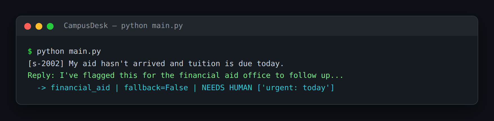

# CampusDesk — Student-Helpdesk Ticket-Triage Pipeline

> **Short description:** An LCEL pipeline that triages university help-desk messages. It classifies each message into the right office (structured output), runs three student lookups in parallel, drafts a reply with a safe fallback when the model call fails, streams it live, and captures one structured record per message with flags for "used the fallback" and "needs a human."

**Tech:** Python · LangChain (LCEL: `with_structured_output`, `RunnableParallel`, `RunnableLambda`, `.with_fallbacks()`, `.stream()`) · Pydantic  ·  **Type:** LCEL pipeline (classify → look up → reply → record)  ·  **Level:** Intermediate

## Overview

A real LLM feature is a *pipeline*, not one call. CampusDesk is four LCEL patterns chained into a student help desk:

- **Classify** — `prompt | model.with_structured_output(TicketCategory)` sorts the message into `enrollment` / `financial_aid` / `it_support` with a reason and a `sure` flag, wrapped with an **unsure fallback**.
- **Look up** — a `RunnableParallel` fires three lookups (status, open requests, next deadline) **at once** and merges them.
- **Reply** — a per-category chain drafts a reply, wrapped with `.with_fallbacks()` → a retry and a safe canned holding reply.
- **Record** — the reply **streams** live, and one structured `TicketRecord` captures it with `used_fallback` and `needs_human_review`.

## Why

Support triage, claims intake, order routing, inbox assistants — they're all this shape: route the input, gather context in parallel, degrade safely when a call fails, and leave a structured trail. LCEL makes parallelism, fallbacks, and streaming one trustworthy line each instead of bespoke per-chain code. The "flag unsure or urgent for a human" habit keeps an auto-responder from confidently mishandling the one message that mattered.

## Features

- Structured classification into a fixed `Literal` category, with an unsure fallback.
- Three lookups run in parallel (≈ the slowest, not the sum).
- Per-category reply chains with a retry + canned-reply fallback; `used_fallback` detectable.
- Live streaming of the reply (`.stream()` + `flush=True`).
- One `TicketRecord` per message; `needs_human_review` set on an unsure classification or an urgent signal.

## Demo



```
$ python main.py
[s-2002] My financial aid hasn't arrived and tuition is due today.
Reply: Thanks — I can see your tuition deadline is today. I've flagged this
for the financial aid office to follow up urgently...
  -> financial_aid | fallback=False | NEEDS HUMAN ['urgent signal: today']
```

## Architecture

```
student message
      |
      v
classify (prompt | model.with_structured_output(TicketCategory))
      |   (parse fails -> unsure fallback)
      v
look up (RunnableParallel: status + open_requests + deadline, at once)
      |
      v
reply (prompt | model | parser).with_fallbacks([canned])   -> streamed live
      |
      v
TicketRecord: category, reply, used_fallback, needs_human_review, reasons
```

## Project Structure

```
<repo folder>/   (CampusDesk-Student-Helpdesk-Ticket-Triage-Pipeline/)
├── data/
│   ├── students.json
│   └── time_lookups.py        one-after-another vs. parallel
├── src/
│   ├── chains/
│   │   ├── __init__.py
│   │   ├── classifier.py      build_classifier_chain(), classify_ticket()
│   │   ├── fallback.py        with_unsure_category(), with_canned_reply()
│   │   ├── lookups.py         build_lookup_step() (RunnableParallel)
│   │   └── replies.py         build_reply_chain()
│   ├── models/
│   │   ├── __init__.py
│   │   └── llm.py
│   ├── prompts/
│   │   ├── classifier.txt
│   │   └── reply.txt
│   ├── services/
│   │   ├── __init__.py
│   │   └── pipeline.py        handle_ticket() -> TicketRecord
│   ├── utils/
│   │   ├── __init__.py
│   │   ├── logger.py
│   │   └── prompts.py
│   ├── __init__.py
│   ├── config.py
│   ├── exceptions.py
│   └── schemas.py             TicketCategory, TicketRecord
├── tests/
│   ├── integration/
│   │   └── test_live_pipeline.py
│   └── unit/
│       ├── test_config.py
│       ├── test_fallback.py
│       ├── test_lookups.py
│       ├── test_review.py
│       └── test_schemas.py
├── .env.example
├── .gitignore
├── LICENSE
├── main.py
├── README.md
└── requirements.txt
```

## Getting Started

**Requirements:** Python 3.10+ and an OpenAI API key.

```bash
git clone <this-repo-url>
cd CampusDesk-Student-Helpdesk-Ticket-Triage-Pipeline
python -m venv .venv
source .venv/bin/activate          # Windows: .venv\Scripts\activate
pip install -r requirements.txt
cp .env.example .env               # then put your key in .env
```

## Configuration

| Variable | Required | Default | Meaning |
|---|---|---|---|
| `OPENAI_API_KEY` | yes | — | Your OpenAI API key |
| `LOG_LEVEL` | no | `INFO` | Log verbosity |

## Usage

```bash
python main.py
# see the parallel win:
python -m data.time_lookups
```

## Running the Tests

```bash
# unit — no API key, no network
python -m tests.unit.test_config
python -m tests.unit.test_schemas
python -m tests.unit.test_lookups
python -m tests.unit.test_fallback
python -m tests.unit.test_review

# integration — real model
python -m tests.integration.test_live_pipeline
```

## Error Handling

| Situation | What happens |
|---|---|
| `OPENAI_API_KEY` missing | Stops at startup with one clear line |
| Classifier parse fails | Unsure fallback returns a safe category; message flagged for a human |
| Reply model call fails | Retry, then a canned holding reply; `used_fallback` set — no crash |
| Unsure or urgent message | `needs_human_review` set, with the reasons recorded |

## Design Decisions

- **The category is a fixed `Literal` shape** — a wrong value is caught by Pydantic, not stored; no free-text parsing.
- **Lookups run in parallel** — independent work shouldn't be three sequential waits; `RunnableParallel` is one line.
- **Fallbacks over `try/except` per call** — `.with_fallbacks()` keeps the happy path clean and makes "what happens on failure" one declaration.
- **A canned reply is a fixed string** — so the pipeline can tell a fallback fired by comparing against it, and set `used_fallback`.

## License

MIT — see `LICENSE`.
