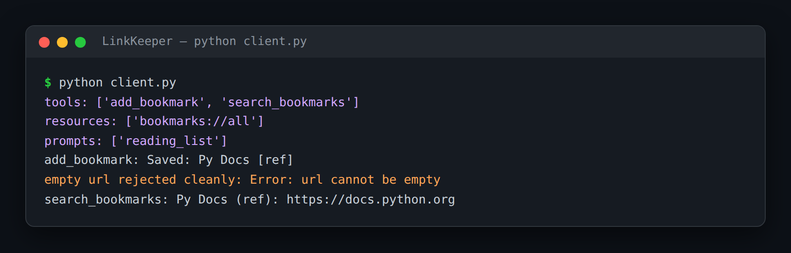

# LinkKeeper — Personal Bookmarks MCP Server (Tools, Resource & Prompt)

> **Short description:** An MCP **server** that any agent can plug into to save, search, and summarize bookmarks. It exposes the three MCP building blocks — **Tools** (`add_bookmark`, `search_bookmarks`), a **Resource** (`bookmarks://all`), and a **Prompt** (`reading_list`) — backed by a **SQLite** store that survives a restart, with a readable `"Error:"` on a bad call. A client is included.

**Tech:** Python · `mcp` (official MCP SDK) · SQLite  ·  **Type:** MCP server + client  ·  **Level:** Intermediate–Advanced

## Overview

MCP is how a capability becomes a *service* any MCP-speaking agent (Claude Desktop, an IDE, your own client) can use — no bespoke integration. LinkKeeper is a bookmarks service, exposed in the three standard shapes:

- **Tools** — `add_bookmark(url, title, tag)` and `search_bookmarks(query)`: actions a client's agent can call.
- **A Resource** — `bookmarks://all`: readable content the client fetches by URI.
- **A Prompt** — `reading_list`: a reusable, named prompt template the server offers.

Behind the tools is a real SQLite store, so bookmarks persist across restarts, and a bad call (empty URL) comes back as a clear `"Error: ..."` string, not a crash. This is the **server** companion to [OpsPilot (8.1)](../project_8.1_opspilot_oncall_mcp_assistant/)'s client, and the twin of [MCPForge (7)](../project_7_mcpforge_mcp_server/).

## Why

Production assistants increasingly get their capabilities from MCP servers a team exposes. Building the server side proves you understand the provider's half of the contract: Tools for actions, a Resource for readable content, a Prompt for reusable wording — discovered at runtime over one protocol. The habits that make it real: a store that persists, errors returned as readable strings, and keeping stdout clean for the protocol.

## Features

- Two tools, one resource, one prompt on a single `MCPServer`, served over stdio.
- SQLite persistence — bookmarks saved in one session are there the next.
- Empty-URL calls return `"Error: url cannot be empty"` (readable string, not a generic failure).
- Logs to **stderr** so stdout stays clean for the MCP protocol.
- A `client.py` that discovers tools/resources/prompts and uses all three.

## Demo



```
$ python client.py
tools: ['add_bookmark', 'search_bookmarks']
resources: ['bookmarks://all']
prompts: ['reading_list']
add_bookmark: Saved: Py Docs [ref]
empty url rejected cleanly: Error: url cannot be empty
search_bookmarks: Py Docs (ref): https://docs.python.org
bookmarks://all: Py Docs (ref): https://docs.python.org
reading_list: Using the bookmarks resource, group the saved lin
```

## Architecture

```
MCP client (any agent)
      |  stdio (initialize handshake)
      v
server.py  (one MCPServer)
  @mcp.tool()      add_bookmark / search_bookmarks  --> src/db.py (SQLite)
  @mcp.resource()  bookmarks://all                  --> src/db.py
  @mcp.prompt()    reading_list                      (reusable wording)
      |
  logs -> STDERR   (stdout is the protocol channel, kept clean)
```

## Project Structure

```
<repo folder>/   (LinkKeeper-Personal-Bookmarks-MCP-Server/)
├── src/
│   ├── utils/
│   │   ├── __init__.py
│   │   └── logger.py          get_logger() — logs to stderr
│   ├── __init__.py
│   ├── config.py              Config, load_config()
│   ├── db.py                  init_db, add/search/all over SQLite
│   └── exceptions.py          MissingConfigError, EmptyBookmarkError
├── tests/
│   ├── integration/
│   │   └── test_server.py     launches the real server over MCP
│   └── unit/
│       ├── test_config.py
│       └── test_db.py
├── .env.example
├── .gitignore
├── LICENSE
├── client.py                  discovers + uses all three building blocks
├── requirements.txt
└── server.py                  the MCP server you run
```

## Getting Started

**Requirements:** Python 3.10+. No API key — this server has no LLM of its own; a client's agent brings the model.

```bash
git clone <this-repo-url>
cd LinkKeeper-Personal-Bookmarks-MCP-Server
python -m venv .venv
source .venv/bin/activate          # Windows: .venv\Scripts\activate
pip install -r requirements.txt
cp .env.example .env               # optional — defaults work
```

## Configuration

| Variable | Required | Default | Meaning |
|---|---|---|---|
| `LINKKEEPER_DB` | no | `linkkeeper.sqlite` | SQLite file path |
| `LOG_LEVEL` | no | `INFO` | Log verbosity (to stderr) |

## Usage

```bash
# run the included client (it launches the server for you)
python client.py

# or inspect the server with the MCP dev tools
mcp dev server.py
```

## Running the Tests

```bash
# unit — no MCP, no network
python -m tests.unit.test_config
python -m tests.unit.test_db

# integration — launches the real server over a real MCP connection
python -m tests.integration.test_server
```

## Error Handling

| Situation | What happens |
|---|---|
| Bookmark with an empty URL | The tool returns `"Error: url cannot be empty"` — no crash |
| Server not reachable from the client | The client prints one clear line, not a raw traceback |
| A `print()` to stdout in the server | Would corrupt the protocol — so all logging goes to stderr |

## Design Decisions

- **Errors as readable strings, not raised exceptions** — in the current `mcp` SDK a tool that raises gives the client only a generic "tool failed." Returning `"Error: ..."` gives a message the client (and its model) can actually read.
- **Log to stderr** — for a stdio server, stdout *is* the protocol channel; logging there breaks the client's parsing.
- **SQLite, not an in-memory list** — a real server's data has to survive a restart; the tests prove it does.

## License

MIT — see `LICENSE`.
