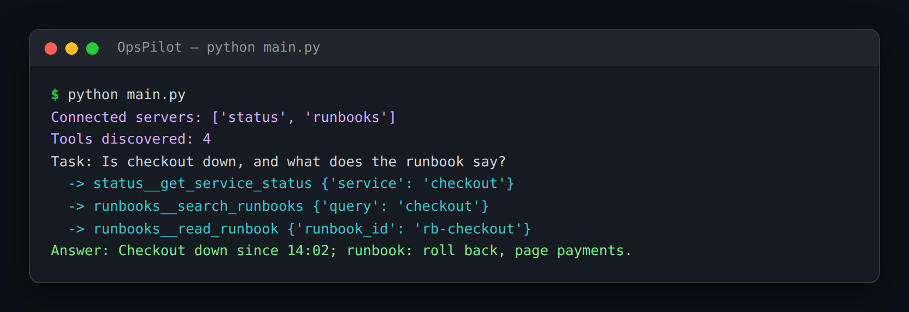

# OpsPilot — On-Call Assistant Over Discovered MCP Tools

> **Short description:** An on-call assistant that answers incident questions by reaching into internal services — a status service and a runbooks service — whose tools it **discovers at runtime over MCP**, never hardcodes. Ask "is checkout down, and what's the runbook?" and it gathers from both and answers.

**Tech:** Python · `mcp` (official MCP SDK) · OpenAI SDK (function calling) · asyncio · Pydantic  ·  **Type:** Single agent (ReAct over discovered MCP tools)  ·  **Level:** Intermediate–Advanced

## Overview

During an incident, the on-call engineer gathers from a few places — the status dashboard, the deploy log, the runbook wiki — then decides. OpsPilot does the gathering. It connects to those services (each an **MCP server**), discovers whatever tools they expose, and runs a think→act→observe loop over them — the same loop as any tool-calling agent, pointed at a **discovered** tool list instead of a written one.

- **Discovers, never hardcodes** — tools come from `list_tools()` at runtime, so a new tool the status team ships just appears.
- **Many services at once** — tool names are namespaced (`status__get_service_status`) so two services never collide, and every call routes back to the right one.
- **Survives a dead dependency** — if the status service is down mid-incident, OpsPilot answers from runbooks and says so, instead of crashing.

## Why

At a real company the status service and the runbook wiki are owned by different teams and change on their own schedules. Hardcoding a copy of each team's tools means every change has to be copied by hand. Discovering them at runtime means OpsPilot always matches what each service offers *right now* — which matters most exactly when teams ship independently.

## Features

- Runtime tool discovery over stdio with `list_tools()` — no tool in the agent's own code.
- Hand-built ReAct loop (no `create_agent`/`AgentExecutor`), bounded by a hard step cap.
- Schema bridge from MCP's `input_schema` to OpenAI's function-calling shape.
- Multi-service pool with namespacing (`service__tool`) and a routing table.
- Per-service connect timeout; an unreachable service is skipped, a mid-call failure becomes a clear observation.
- Two example services (status, runbooks) so it runs with no external setup.

## Demo



```
$ python main.py
Connected servers: ['status', 'runbooks']
Tools discovered: 4

Task: Is checkout down right now, and what does the runbook say to do about it?
  -> status__get_service_status {'service': 'checkout'}
  -> runbooks__search_runbooks {'query': 'checkout'}
  -> runbooks__read_runbook {'runbook_id': 'rb-checkout'}
Answer: Checkout has been down since 14:02 (503 rate 88%). The runbook says
to roll back the last deploy, then page payments.
```

With the status service not started, the run prints
`Connected servers: ['runbooks']` and answers from the runbook, noting it
couldn't reach live status.

## Architecture

```
your question
   │
   ▼
run_agent ──► ask model (question + discovered tool schemas)
   │                 │
   │          tool_calls?  ──no──►  final answer
   │                 │ yes
   │                 ▼
   │          MCPServerPool.call_tool("status__get_service_status", {...})
   │                 │   (routing table → right service's session)
   │                 ▼
   │          observation (CallToolResult.content[0].text)
   └───────────◄─────┘   (appended, loop repeats, bounded by max_iterations)

startup:  connect to each service → list_tools() → namespace "service__tool"
          unreachable service → logged and skipped, not fatal
```

## Project Structure

```
<repo folder>/   (OpsPilot-On-Call-Assistant-Over-Discovered-MCP-Tools/)
├── servers/
│   ├── runbook_server.py       example MCP service (runbooks)
│   └── status_server.py        example MCP service (status)
├── src/
│   ├── models/
│   │   ├── __init__.py
│   │   └── llm.py              create_client(), ask_model()
│   ├── utils/
│   │   ├── __init__.py
│   │   └── logger.py           get_logger() — logs to stderr
│   ├── __init__.py
│   ├── agent.py                run_agent() ReAct loop, AgentResult
│   ├── config.py               Config, load_config()
│   ├── exceptions.py           MissingConfigError, MaxIterationsExceeded, …
│   ├── server_pool.py          MCPServerPool: connect, discover, route
│   ├── servers_config.py       SERVERS = [{name, command, args}, …]
│   └── tool_bridge.py          mcp_tools_to_openai_schema(), extract_text()
├── tests/
│   ├── integration/
│   │   └── test_agent.py       real services: discovery, routing, fallback
│   └── unit/
│       ├── test_config.py
│       └── test_tool_bridge.py
├── .env                        your real key — never committed
├── .env.example
├── .gitignore
├── LICENSE
├── main.py
├── README.md
└── requirements.txt
```

## Getting Started

**Requirements:** Python 3.10+, an OpenAI API key. The example services in `servers/` work out of the box.

```bash
git clone <this-repo-url>
cd OpsPilot-On-Call-Assistant-Over-Discovered-MCP-Tools
python -m venv .venv
source .venv/bin/activate          # Windows: .venv\Scripts\activate
pip install -r requirements.txt
cp .env.example .env               # then put your key in .env
```

## Configuration

| Variable | Required | Default | Meaning |
|---|---|---|---|
| `OPENAI_API_KEY` | yes | — | Your OpenAI API key |
| `LOG_LEVEL` | no | `INFO` | Log verbosity |
| `MCP_CONNECT_TIMEOUT` | no | `10` | Seconds to wait for a service to start |
| `MCP_MAX_ITERATIONS` | no | `6` | Hard cap on ReAct steps |

## Usage

```bash
python main.py
```

Point OpsPilot at your own internal services by editing `src/servers_config.py`.

## Running the Tests

```bash
# unit — no service, no network
python -m tests.unit.test_config
python -m tests.unit.test_tool_bridge

# integration — launches the example services over a real MCP connection
python -m tests.integration.test_agent
```

## Error Handling

| Situation | What happens |
|---|---|
| `OPENAI_API_KEY` missing | Stops at startup with one clear line |
| A service never finishes starting | `initialize()` times out; that service is logged and skipped |
| A service's launch command is wrong | Connection raises; caught, logged, skipped — others still connect |
| A tool call fails mid-incident | A clear `Error: …` observation goes back to the model |
| The model loops without finishing | `MaxIterationsExceeded` after the hard cap |

## Design Decisions

- **Namespacing uses `__`, not `.`** — OpenAI function names allow only letters, digits, `_`, `-`; the routing table maps `status__get_service_status` back to `("status", "get_service_status")`.
- **Async throughout** — the `mcp` client is async-only; `main.py` wraps everything in `asyncio.run()`.
- **Contexts entered in the main task** — never inside `asyncio.wait_for` (a new task), which would break teardown; only `initialize()` is timed out.

## License

MIT — see `LICENSE`.
